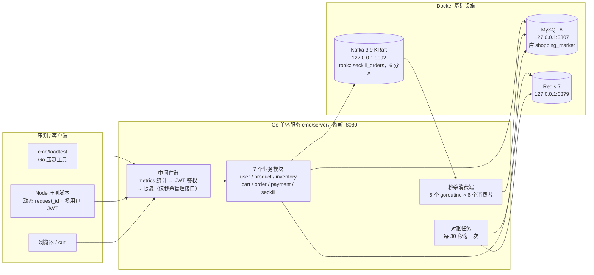
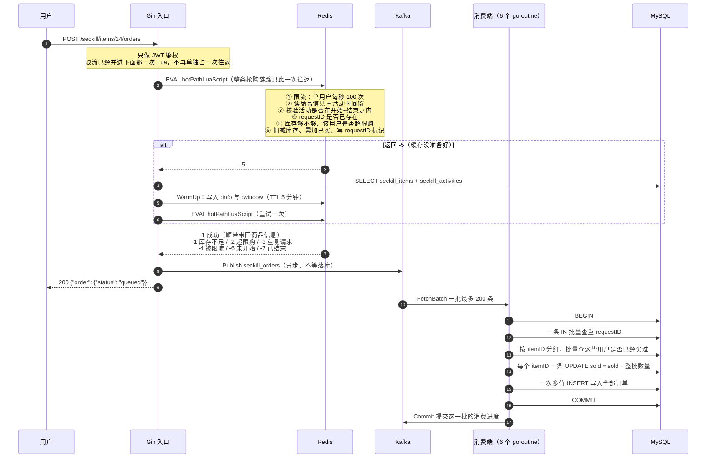
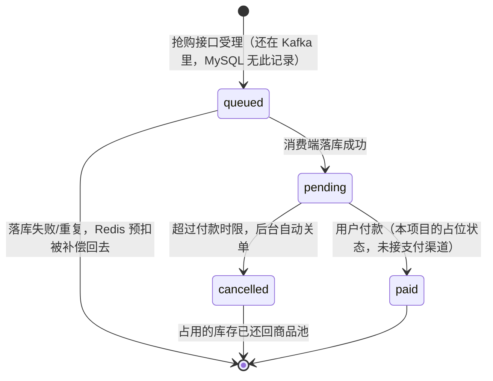
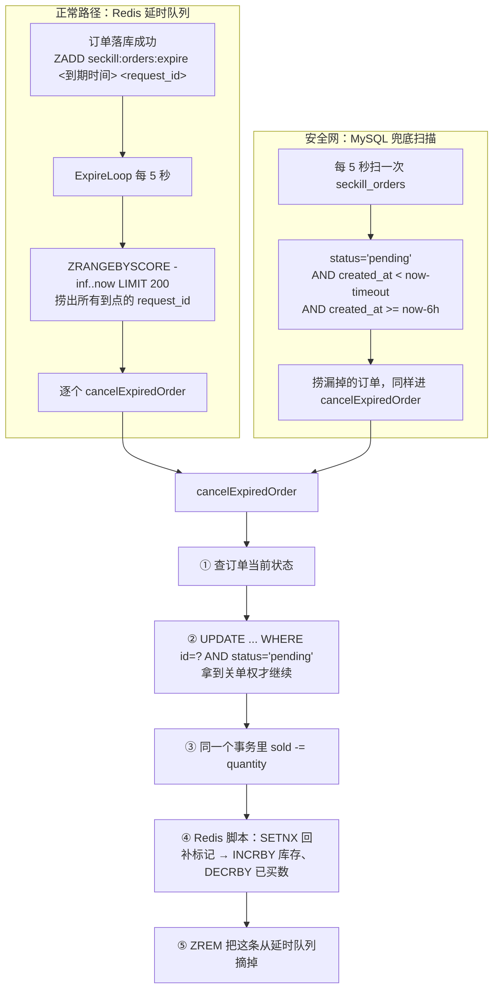
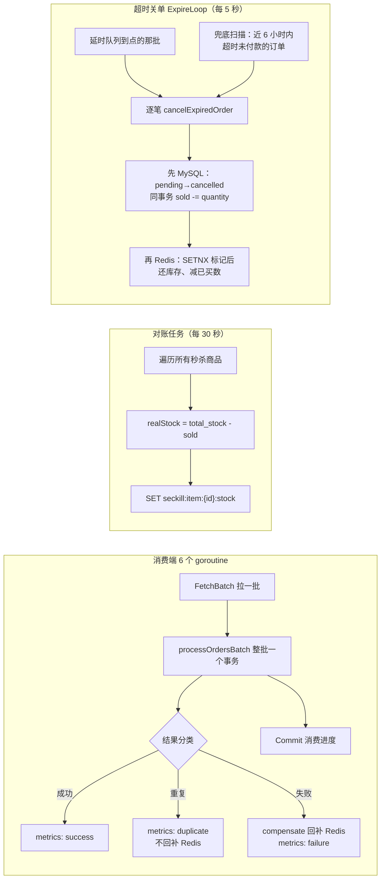

# 秒杀购物平台 · 架构说明

这份文档回答三个问题：**项目长什么样**、**一次秒杀请求从进来到落地经过了哪些地方**、
**每个零件各自负责什么**。

图用 Mermaid 画，在 GitHub、GitLab 或装了 Mermaid 插件的编辑器里能直接渲染成图；
纯文本阅读时也能看懂箭头方向。

## 1. 一句话介绍

这是一个 Go 写的网上商城**单体服务**。除了常规的「注册登录 → 逛商品 → 加购物车 → 下单 → 支付」，
额外做了一条**秒杀**链路：用 Redis 扛住瞬时流量、用 Kafka 把洪峰削平、用 MySQL 做最终的账本。

## 2. 整体部署图



**怎么读这张图**：客户端只跟 Go 服务打交道；Go 服务是所有逻辑的大脑；
MySQL、Redis、Kafka 是三个「外部帮手」，分别负责**存账本**、**顶流量**、**排队**。

> 上面画的是**单体模式**（默认，也是压测基线）。阶段 13~15 又在这基础上加了三个**可选**的独立进程：
> `cmd/gateway`（`:8081`）→ `cmd/user`（`:8082`）、`cmd/seckill`（`:8083`）。
> 不启动它们时这张图就是完整事实；启动后让单体用 `USER_MODULE=0` / `SECKILL_MODULE=0` 让位即可。
> 拆分过程与代价见第 10 节、`docs/microservices.md`。

## 3. 代码分层

```
cmd/
  server/        服务入口：装配所有模块、启动消费端和对账任务
  loadtest/      Go 压测工具
internal/
  user/          注册 / 登录 / JWT 鉴权
  product/       商品与 SKU
  inventory/     普通库存（非秒杀场景用）
  cart/          购物车
  order/         普通下单、支付 / 取消状态流转
  payment/       支付回调
  seckill/       秒杀（本项目重点）
  shop/          独立前台（阶段 7）：商品列表页 + 秒杀独立页，只做组装
  demo/          演示控制台（阶段 6.2）：给人看的仪表盘，只做组装
  config/        配置读取
  pkg/           公共工具
    db/          MySQL 连接池
    redis/       Redis 客户端
    kafka/       Kafka 生产者 / 消费者封装
    jwt/         JWT 签发与校验
    metrics/     自研轻量指标（对外暴露 /metrics）
    ratelimit/   基于 Redis 的滑动窗口限流（按 IP，给秒杀管理接口用）
```

每个业务模块内部基本都是同一套「四件套」，看懂一个就会看懂全部：

| 文件 | 职责 | 打比方 |
| --- | --- | --- |
| `model.go` | 数据长什么样、对应哪张表 | 表格的列定义 |
| `repository.go` | 只跟数据库打交道，不含业务判断 | 仓库管理员 |
| `service.go` | 业务规则，决定「这件事能不能做」 | 店长 |
| `handler.go` + `router.go` | 解析 HTTP 请求、把结果写回响应 | 前台接待 |

这么做的好处：**换数据库只改 repository，改业务规则只改 service，改接口格式只改 handler**，
三个人的活互不打架，也方便以后拆成微服务（按模块直接切走就行）。

## 4. 秒杀主链路

### 4.1 时序图



### 4.2 关键点：用户拿到的 `pending` 是什么意思

接口返回 200 时，**订单还没有真正写进 MySQL**。用户拿到的是一张「排队凭证」，
接口里这个订单的 `status` 是 `queued`（排队中）；等消费端真正写进 MySQL 后，库里的状态是 `pending`：

- Redis 已经扣掉了库存，说明这个名额**确实留给他了**；
- 真正的订单由消费端稍后写入 MySQL，状态先是 `pending`；
- 因为 Redis 扣减成功就意味着「一定能落库」（除非数据库整个挂掉），
  所以对用户来说这个承诺是可信的。

这就是典型的**「先扣减、后落库」异步下单模型**，也是秒杀能扛住高并发的原因：
入口只做**一次 Redis 往返** + 一次 Kafka 发送，全程不碰 MySQL 那台慢机器。

### 4.3 三层防线（面试重点）

| 层次 | 位置 | 挡住什么 | 靠什么实现 |
| --- | --- | --- | --- |
| 第一层 | 热路径 Lua 里的限流；管理接口另有一层 Gin 限流中间件 | 挡住刷接口的机器流量 | 抢购接口按**用户**限流（**任意** 1 秒内最多 100 次，滑动窗口，和扣减共用同一次 Redis 往返）；建活动等管理接口按 IP 限流 |
| 第二层 | Redis Lua 脚本 | 挡住超卖、超限购、重复提交、活动未开始/已结束 | `hotPathLuaScript` 一次原子完成全部校验与扣减 |
| 第三层 | MySQL 条件更新 + 唯一索引 | 挡住前两层万一漏掉的情况 | `sold + N <= total_stock` 条件更新；`request_id` 唯一索引（`(item_id,user_id)` 在阶段 9 改成了普通索引，原因见 4.4） |

前两层是**性能手段**（把流量挡在数据库之外），第三层是**正确性底线**（哪怕前面全出错，数据库也不会超卖）。
这个「性能与正确性分离」的思路，是秒杀设计里最值得讲的一点。

### 4.4 订单状态机与超时关单（阶段 9）

`pending` 不是终点。一张秒杀订单的完整生命周期是：



| 状态 | 含义 | `sold` 里算不算占用 | Redis 库存 |
| --- | --- | --- | --- |
| `queued` | 接口已受理，仅在 Kafka 中，MySQL 里查不到 | 已扣（Redis 预扣那一下） | 已扣 |
| `pending` | 已落库，等待付款 | 算 | 已扣 |
| `paid` | 已付款，库存真正归该用户 | 算 | 已扣 |
| `cancelled` | 超时未付款被关单 | **不算**（关单时已减回去） | 已还回 |

**为什么要有关单这件事**：订单落库后停在 `pending`、永远没有下文的话，
「抢到不付钱」就等于**永久占住库存**——用脚本把 1000 件全抢下来一直不付款，
商品就再也卖不出去了。这是电商里真实存在的「占库存」攻击，所以必须有超时关单。

**怎么实现：延时队列 + 兜底扫描**，两条路并行：



**关单为什么必须「先 MySQL 再 Redis」**：反过来的话，先把库存加回 Redis、
再改 MySQL 时失败了，库存就凭空多出一份——那是**超卖**；
正着来中途失败只是「Redis 暂时少一份库存」，属于**少卖**，
下一轮重试或对账都能补上。一句话：**朝安全的方向失败**。

**为什么幂等要做两层**：

- MySQL 层：条件更新 `WHERE id=? AND status='pending'`，
  只有 `RowsAffected = 1` 的那一次调用才算真的关单；重复调用时已经没有 `pending` 的行了。
- Redis 层：`SETNX seckill:order:{requestID}:restored` 抢标记，只有第一个调用者真的回补。
  光靠 MySQL 那层不够，因为「关单 → 用户重新抢购 → 再回补一次」这个场景下，
  按「用户已买数够不够扣」是判断不出来的（详见 `expire.go` 里 `restoreOnceLuaScript` 的注释）。

**`sold` 的语义在阶段 9 被明确成「还没被取消的订单占用的库存」**（含 `pending`，不含 `cancelled`）。
这么定是因为对账任务是拿「`total_stock - sold`」反推 Redis 库存的，
关单时如果不把 `sold` 一起减回去，下一次对账会把它按「还占着」重新算，刚还的库存又被吞掉。

**`idx_user_item` 为什么从唯一索引降级成普通索引**：
唯一索引意味着「一个用户在一个商品上只能有一行订单」。有了关单之后这会挡路——
用户超时被关单后想重新抢，插新行会撞唯一索引失败。
所以唯一性改由业务层判断（`status IN ('pending','paid')` 才算买过），
真正的守门员是 Redis 里按用户计数的 key。
注意 `AutoMigrate` 发现同名索引已存在就跳过、**不会改**，所以需要 `migrate.go`
在启动时查一次 `information_schema` 做一次性修正。

## 5. 秒杀模块文件分工

| 文件 | 负责什么 |
| --- | --- |
| `model.go` | `Activity`（活动）、`Item`（秒杀商品）、`Order`（秒杀订单）三个结构体 |
| `repository.go` | 单条与批量两套数据库方法：查商品、查活动、查重、扣库存、写订单 |
| `cache.go` | Redis 相关全部在这里：热路径大脚本 `hotPathLuaScript`、回滚脚本 `rollbackLuaScript`、冷路径 `WarmUp`、库存对账写回 |
| `queue.go` | Kafka 消息结构 `OrderMessage`、发消息、批量拉取解析、批量提交 |
| `worker.go` | 消费端主循环 `consumeLoop`、整批落库 `processOrdersBatch`、失败补偿 `compensate` |
| `reconcile.go` | 定时对账：拿 MySQL 的 `sold` 重新算 Redis 库存并覆盖 |
| `expire.go` | 超时关单（阶段 9）：延时队列的读写、`ExpireLoop` 主循环、关单与库存回补 `cancelExpiredOrder` |
| `migrate.go` | 启动时的一次性索引修正：把 `idx_user_item` 的唯一约束去掉、补建兜底扫描要用的 `(status, created_at)` 索引 |
| `service.go` | 秒杀入口 `Seckill`：校验参数 → 一次 Lua 完成「限流 + 校验 + 预扣」→ 发 Kafka；缓存没准备好时回源 MySQL 填缓存后重试一次 |
| `handler.go` / `router.go` | HTTP 层与路由注册 |

## 6. Redis Key 设计

| Key 格式 | 含义 | 类型 | 有效期 | 谁写 |
| --- | --- | --- | --- | --- |
| `seckill:item:{itemID}:stock` | 剩余库存 | 整数 | 不过期 | 热路径 Lua 预扣 / 对账覆盖 |
| `seckill:item:{itemID}:user:{userID}` | 该用户在该商品上已买数量 | 整数 | 不过期 | 热路径 Lua 预扣 / 补偿回滚 |
| `seckill:request:{requestID}` | 幂等标记，存在即说明这个请求来过了 | 字符串 | 86400 秒 | 热路径 Lua 预扣 |
| `seckill:item:{itemID}:info` | 商品信息缓存（含 `total_stock`、`per_user_limit`） | JSON | 5 分钟 | 冷路径 `WarmUp` 回源后写回 |
| `seckill:item:{itemID}:window` | 商品所属活动的时间窗，内容是 `开始时间戳:结束时间戳`（Unix 秒） | 字符串 | 5 分钟 | 冷路径 `WarmUp` 写回 |
| `ratelimit:seckill:user:{userID}` | 抢购接口的限流**滑动窗口**（按用户）：member 是 `requestID`，score 是放行时刻的毫秒时间戳 | 有序集合 ZSET | 最后一次放行后再过 1 个窗口（1 秒） | 热路径 Lua |
| `ratelimit:{IP}` | 秒杀管理接口的限流**滑动窗口**（按 IP）：member 是 `毫秒-进程内序号`，score 是放行时刻的毫秒时间戳 | 有序集合 ZSET | 最后一次放行后再过 1 个窗口（1 秒） | `ratelimit` 中间件 |
| `seckill:orders:expire` | 超时关单的**延时队列**：member 是 `requestID`，score 是「到期时间戳」（Unix 秒） | 有序集合 ZSET | 不过期（处理完即 `ZREM`） | 消费端落库成功后 `ZADD`；`ExpireLoop` 处理后摘除 |
| `seckill:order:{requestID}:restored` | 「这一单的库存已经回补过」的幂等标记 | 字符串 | 7 天 | 关单的 Redis 脚本 `SETNX` |

注意 `:stock` 和 `:info` 是**两个不同的 key**，不能混用：
前者是随时在变的整数，后者是可以放心缓存 5 分钟的 JSON。

为什么活动时间要单独存一个 `:window` 字符串：热路径要在 Lua 里校验活动时间，
而 Lua 解析 RFC3339 时间串很别扭。提前在 Go 里换算成两个整数拼起来，
脚本切一刀就能拿到，既快又不依赖时间格式。
`:window` 挂在**商品 ID** 而不是活动 ID 上，是因为抢购接口只拿得到商品 ID，
而一个商品只属于一场活动，用商品 ID 一样唯一。

两个限流 key 在阶段 10 从「整数计数」改成了「ZSET 记时刻」。
老写法是 `ratelimit:seckill:user:<用户ID>:<窗口号>`，窗口号 = `当前毫秒 / 1000`，
等于把时间切成一个个「自然秒」。这有个人尽皆知的洞：同一个用户在第 1 秒的最后 10 毫秒
打 100 次、第 2 秒的头 10 毫秒再打 100 次，两次落在**不同的窗口**里、各自都「没超」，
可现实里这 20 毫秒内已经放过了 200 次——上限被放大成 2 倍。
新写法是**不数数，而是把每次放行的时刻记下来**：`ZADD <限流 key> <放行时刻毫秒> <成员>`，
判断时先 `ZREMRANGEBYSCORE` 删掉已经滑出窗口的旧记录、再 `ZCARD` 数剩下几条，
依据从「现在是第几个固定窗口」变成「最近 1000 毫秒内到底放行过几次」，
没有窗口翻页，也就没有那个边界瞬间。因为窗口是滑动的，key 里不再需要窗口编号，
整条 key 靠脚本里的 `PEXPIRE` 在「最后一次放行之后再过一整个窗口」自然消失。

## 7. HTTP 接口清单

**无需登录**

| 方法 | 路径 | 作用 |
| --- | --- | --- |
| GET | `/health` | 健康检查，返回 `{"status":"ok"}` |
| GET | `/metrics` | 指标快照（见第 9 节） |
| POST | `/register` | 注册 |
| POST | `/login` | 登录，返回 JWT |
| POST | `/products` | 创建商品 |
| GET | `/products` | 商品列表 |
| GET | `/products/:id` | 商品详情 |
| DELETE | `/products/:id` | 删除商品 |
| POST | `/products/:id/skus` | 给商品加 SKU |
| POST | `/stocks` | 创建库存记录 |
| GET | `/stocks/:sku_id` | 查库存 |
| POST | `/stocks/:sku_id/deduct` | 扣库存 |

**需要登录（请求头带 `Authorization: Bearer <token>`）**

| 方法 | 路径 | 作用 |
| --- | --- | --- |
| POST / GET / PATCH / DELETE | `/cart/items`、`/cart/items/:item_id` | 购物车增删改查 |
| POST | `/orders` | 普通下单（带 `request_id` 做幂等） |
| GET | `/orders/:id` | 查订单 |
| POST | `/orders/:id/pay` | 支付订单 |
| POST | `/orders/:id/cancel` | 取消订单 |
| POST | `/payments/:order_id/callback` | 支付回调 |
| GET | `/payments/:order_id` | 查支付记录 |
| POST | `/seckill/activities` | 创建秒杀活动 |
| GET | `/seckill/activities` | 秒杀活动列表 |
| POST | `/seckill/activities/:id/items` | 给活动添加秒杀商品 |
| GET | `/seckill/activities/:id/items` | 查看活动下的秒杀商品 |
| POST | `/seckill/items/:item_id/orders` | **抢购（核心接口）** |

**演示控制台（阶段 6.2，同样无需登录）**

| 方法 | 路径 | 作用 |
| --- | --- | --- |
| GET | `/demo` | 演示页面本体（`go:embed` 打进二进制，原生 JS，无构建工具） |
| GET | `/demo/data` | 只读：秒杀商品 + Redis 剩余库存 + Kafka 在途订单数 |
| POST | `/demo/seed` | 一键造演示数据（商品/SKU/库存/活动/演示账号），`DEMO_SEED=0` 时返回 403 |

这三条路由挂在 `.tmp` 之外的最外层 `internal/demo` 包，只做「组装」，不碰数据库表；
页面上点抢购走的仍然是上面那条 `/seckill/items/:item_id/orders`，照样要 JWT。

页面的第 ⑥ 区块是**压测命令生成器**（阶段 8），它只把 `MODE` / `VUS` / `HOLD` / `ITEM`
拼成一条可以粘贴执行的 k6 命令，**不在服务端启动任何外部进程**。
原因有两条：压测端和被压服务抢同一台机器的 CPU 会让数字失真（`docs/benchmark.md` 实测两个 k6
并行时总吞吐反而下降），而「Web 接口 exec 外部进程」本身就是一条远程命令执行的风险面。
`NS` 参数故意不生成，交给脚本用毫秒时间戳保证每轮唯一；商品 ID 取自第 ③ 块当前选中的秒杀商品。

**可观测接口（阶段 6.3，同样无需登录）**

| 方法 | 路径 | 作用 |
| --- | --- | --- |
| GET | `/metrics` | 累计值快照（原来就有；6.3 之后多了完成数、5xx/4xx 数、平均延迟、当前并发） |
| GET | `/metrics/history` | 最近 900 个采样窗口（2 秒一个，约 30 分钟），把累计值换算成每秒速率 |
| GET | `/metrics/alerts` | 此刻在响的告警、最近的状态变化、每条规则的当前值/门槛/平时基线 |

这三条仍然落在 `ignoredPrefixes` 里，随便轮询都不会污染压测口径。

**独立前台（阶段 7，`internal/shop` 包）**

| 方法 | 路径 | 作用 | 鉴权 |
| --- | --- | --- | --- |
| GET | `/shop` | 商品列表页（含秒杀专场横幅、商品卡、我的订单） | 不需要 |
| GET | `/shop/seckill` | 秒杀独立页（`?item=N` 指定抢哪个） | 不需要 |
| GET | `/shop/data` | 只读：商品 + SKU + 当前活动 + 秒杀商品（含 Redis 剩余库存） | 不需要 |
| GET | `/shop/my` | 当前登录用户的秒杀订单 | **需要 JWT** |

几个刻意的设计：

- **为什么不复用 `/demo`**：`/demo` 讲「系统内部在干什么」，`/shop` 讲「用户看到了什么」。
  同一套后端、同一台服务，双屏并排时对比本身就是讲解内容。
- **为什么秒杀要单独一个页面**：真实电商的秒杀页会独立部署、独立扩容，
  因为它要扛瞬时流量，和「商品详情」这种读多写少的页面不是一个量级。
  本项目用独立的 `/shop/seckill?item=N` 把这个划分体现出来，但背后走的是同一套接口。
- **为什么秒杀页的轮询不塞进秒杀路由组**：秒杀管理路由组上挂着按 IP 的自适应限流（5~100/s），
  页面自己每秒轮询会把自己限流掉。`/shop/data` 是独立只读接口，不经过那一组。
- **抢购成功后为什么不能拿返回的 `order.id` 去查订单**：热路径返回的是内存里构造的
  `Order{Status:"queued"}`，`ID` 还是 0（数据库自增还没发生）。正确做法是用 `request_id` 反查——
  `/shop/seckill` 页面就是这么做的。
- **`/shop/my` 为什么不拼商品名**：要按 `item_id` 一条条回查就是 N+1 次查询；
  而页面本来就在轮询 `/shop/data`，商品名它手上已经有了，前端查表拼一下就行。
- **`/shop/data` 的规格查询走批量**：`ListSKUsByProductIDs` 用一条 `IN` 查询取回所有商品的规格，
  由调用方按 `product_id` 分组，避免「for 每个商品查一次」的 N+1（这个接口每秒被拉一次）。
- **付款时限由服务端下发（`pay_timeout_seconds`，阶段 9）**：秒杀页和订单列表的倒计时都用它算，
  前端**不写死** 15 分钟。因为后端支持用环境变量 `SECKILL_PAY_TIMEOUT` 把时限调短（演示用），
  写死的话页面会说「还剩 15 分钟」而订单其实 30 秒后就被关掉了，看上去就像系统算错了。

`/shop` 和 `/demo`、`/metrics` 一样加进了 `ignoredPrefixes`。原因不只是「数字好看」：
页面每秒轮询，如果计入 `totalRequests`，它的耗时会被算进平均延迟，
而自适应限流正是根据延迟来决定「系统是不是太忙」——口径被污染会让限流**误判系统繁忙而主动降低阈值**。

## 8. 后台任务

服务启动时会额外拉起两类后台工作，它们不在请求链路上，但保证最终正确性：



- **消费端**：负责把 Kafka 消息真正写进 MySQL；失败时把 Redis 预扣的库存还回去（补偿）。
- **对账任务**：兜底中的兜底。万一补偿也失败，30 秒内一定会用 MySQL 的账本把 Redis 修正回来。
- **超时关单**：把「抢到不付钱」占住的库存还回商品池（阶段 9，详见 4.4）。

这三者之间有一个必须注意的交叉点：关单要分两步（先 MySQL 后 Redis），
两步之间 MySQL 的 `sold` 已经减了、Redis 库存还没加回来，**两边正好差这一份**。
如果对账任务正好在这一瞬间跑，它会按 MySQL 反推、把这笔账算错。
所以关单前后会给一个原子计数器 `inFlightExpiry` 加一/减一，
对账任务每次先看一眼，非 0 就本轮跳过（`reconcile.go`）。
它**不是锁**，只是给对账任务的一个信号。

另外，兜底扫描的查询条件是 `status = 'pending' AND created_at` 落在
「超时点」到「6 小时前」之间，排序走 `created_at`——这三件事必须一起配合，
才能用上 `(status, created_at)` 复合索引。少了索引，这个每 5 秒一次的小任务
会退化成 440 万行全表扫描（实测每次 1.6~1.8 秒），扫描本身就是事故。

`/metrics` 暴露的计数：`seckillRequests`、`seckillSuccess`、`seckillFailure`、
`seckillDuplicate`、`rateLimited`。

**口径提醒（讲演示页时最容易说错的地方）**：

- `seckillRequests` 是**入口口径**——请求打到抢购接口就 +1，包含后面可能失败的那些；
- `seckillSuccess / seckillDuplicate / seckillFailure` 是**落库口径**——由消费端
  （`internal/seckill/worker.go`）在真正写 MySQL 之后才上报；
- 所以同一时刻两者对不上是**正常的**，差值就是「还在 Kafka 里排队的订单」，
  对应演示页上的 `pending`。等消费追平，`seckillSuccess` 会慢慢追上 `seckillRequests`。

另外，`/demo` 和 `/metrics` 这两个前缀被 `internal/pkg/metrics/middleware.go`
里的 `ignoredPrefixes` **排除在 `totalRequests` 之外**。原因是演示页每秒都在轮询，
如果算进去会把压测口径彻底污染。

### 8.1 观测与告警（阶段 6.3）

**一句话**：让系统自己发现异常，而不是靠人盯屏幕。

- **采样器**（`internal/pkg/metrics/window.go`）：每 2 秒把累计值（「一共处理了多少请求」）
  换算成速率（「每秒处理多少请求」），得到一组观测值交给告警引擎，并保留最近 900 个样本
  （约 30 分钟）。`/metrics/history` 看到的就是这张心电图。
- **告警引擎**（`internal/pkg/metrics/alert.go`）：每条规则要连过三关才算「真异常」——
  1. **绝对下限** `Floor`：太低的值连看的必要都没有（比如 QPS 不到 500 根本不算突发流量）；
  2. **相对基线** `Sigma`：拿最近 30 个窗口算平均值和标准差，偏离基线 4 倍标准差才算「和平时不一样」；
  3. **连续确认** `Consecutive`：连续 3 个窗口都越线才真正报警，避免一个毛刺就响。
  最终门槛取「基线 + Nσ」和 `Floor` 里**更严的那个**；异常恢复后还会发一次恢复事件，
  带上持续时长和峰值。
- **默认四条规则**（`rules.go`）：突发流量、服务端错误率、Kafka 消费积压、在途订单积压。
  **没有**「流量骤降」规则——压测一结束流量必然回落，那是已知的正常现象，开了只会天天误报。
- **积压探针**（`internal/pkg/kafka/lag.go`）：每 5 秒查一次「消费组落后多少条消息」，
  结果缓存在内存里，采样器只读缓存、不做网络请求，所以采样节奏不会被 Kafka 拖慢。
  **为什么不看 `Reader.Stats().Lag`**：消费组模式下那个字段恒为 -1，所以这里用
  `Client.Metadata` + `ListOffsets` + `OffsetFetch` 自己算。
- **自适应限流**（`internal/pkg/ratelimit/adaptive.go`）：借网络里的 AIMD 思路——
  系统健康（平均延迟 ≤ 50ms 且错误率 < 1%）就每个窗口加一点（加性增，每次 +5），
  吃力就立刻砍 30%（乘性减），砍完还要冷却 2 个窗口才重新试探；阈值夹在 5 ~ 100 之间，
  **永远不会超过调用方给的静态上限**。注意它保护的是秒杀的管理类接口；
  抢购热路径的限流在 Lua 脚本里，两者互不影响。
- **压测报告工具**（`cmd/benchreport`）：把 k6 输出、`/metrics` 数据和日志汇成一份 Markdown，
  分五节——k6 视角、服务端视角、系统自报异常、瓶颈线索、原始日志摘录。
  瓶颈线索是**写死的阈值判断，不调用大模型**，这样报告能离线复现、不依赖外部 API。

## 9. 环境与常用命令

| 组件 | 地址 | 说明 |
| --- | --- | --- |
| MySQL | `127.0.0.1:3307` | 用户 `root`，密码 `root`，库 `shopping_market` |
| Redis | `127.0.0.1:6379` | 无密码 |
| Kafka | `127.0.0.1:9092` | KRaft 单机模式，topic `seckill_orders` |
| HTTP 服务 | `:8080` | `cmd/server` |

```bash
make up                 # 启动 MySQL / Redis / Kafka
make run                # 启动服务
make kafka-partitions   # 把 seckill_orders 扩到 6 个分区
make kafka-lag          # 查看消费积压
make bench-report       # 汇总 k6 + 服务端指标 + 日志，生成一份压测报告
```

需要做性能分析（找 CPU 热点）时，用环境变量打开 pprof。
它默认是关的，只有设了 `ENABLE_PPROF=1` 才会额外在 `127.0.0.1:6060` 上开一个
**只绑本机**的分析端口，不影响正常压测：

```bash
ENABLE_PPROF=1 go run ./cmd/server
go tool pprof 'http://127.0.0.1:6060/debug/pprof/profile?seconds=20'
```

详细压测数据见 `docs/benchmark.md`。

## 10. 当前瓶颈与演进方向

**已经做到的**：消费端从约 80 条/秒提升到 1900+ 条/秒，Kafka 不再积压；
入口从「一次抢购 4 次 Redis 往返」合并成 **1 次**，
单机峰值从约 5,900 QPS 提到 **约 16,000 QPS（1 万目标的 1.6 倍）**，
512 VU 下 p50 从 84.7ms 降到 37.1ms。
`sold`、订单数、去重用户数、去重 `request_id` 数、Redis 剩余库存五个口径完全一致。

**下一处瓶颈已经不在代码里**：512 VU 时采的 CPU profile 显示，
约 45% 的时间花在阻塞式 socket 系统调用（`runtime.cgocall`），
其中约 42% 是 `net.(*conn).Write`（把 HTTP 响应写回客户端本身），
业务代码几乎没上榜单。所以再往上走要靠部署层面：
`GOMAXPROCS` 调参、换 Linux（epoll 比 Windows 的 I/O 路径更省）、
HTTP 长连接、单机多实例 + 负载均衡。

**如果以后要变微服务**，切分点已经天然存在：

| 服务 | 拆出去的边界 | 拆分后需要额外处理的事 |
| --- | --- | --- |
| 用户服务（✅ 阶段 14 已落地） | `internal/user` | JWT 校验要么下沉到网关，要么各服务共享公钥 |
| 商品 / 库存服务 | `internal/product`、`internal/inventory` | 库存归属唯一，避免两边同时改 |
| 订单服务 | `internal/order`、`internal/seckill`（秒杀已在阶段 15 单独落地为 seckill-service） | 跨服务事务改用「本地消息表 + 最终一致」 |
| 支付服务 | `internal/payment` | 回调幂等、对账 |

拆分后的代价要提前想清楚：**分布式事务、链路追踪、服务发现、配置中心**都得补上，
所以现阶段保持单体是划算的——**先让单体跑满，再按真实瓶颈拆**，而不是一开始就拆。

**目前已经落地了一部分**：阶段 13 抽出 `cmd/gateway`（`:8081`，旁路式，业务代码一行不改）、
阶段 14 抽出 `cmd/user`（`:8082`）、阶段 15 抽出 `cmd/seckill`（`:8083`）。
单体保留 `USER_MODULE` / `SECKILL_MODULE` 两个开关——设成 `0` 就让位（不再注册那部分路由、
也不再跑对应的 Kafka 消费者和后台任务），不设变量就是原来那个单体，**随时可以回退**。
拆分时刻意遵守一条纪律：**热点链路上一个跳数都不加**，限流 / 判重 / 预扣仍然在同一次 Redis Lua 往返里；
同机复测 1 万 QPS 无掉速（数字见 `docs/build.md` 阶段 15 与 `docs/microservices.md` 第 6 节）。

## 11. 数据库选型对比（为什么是 MySQL）

面试常问「为什么用 MySQL」。下面按本项目的实际需求对比：

| 数据库 | 适合什么 | 放到这个项目里的好处 | 放到这个项目里的代价 |
| --- | --- | --- | --- |
| **MySQL 8**（当前选择） | 有事务、有强一致约束的关系型数据 | 唯一索引能直接兜住防重；条件更新 `sold + N <= total_stock` 一条 SQL 防超卖；生态成熟、面试官熟悉 | 单机写入有上限；高并发下同一行库存是热点 |
| PostgreSQL | 复杂查询、JSON、地理信息 | 约束更强（CHECK 约束能直接在库里校验库存非负），并发控制更细 | 本项目的瓶颈是「同一行的行锁竞争」，换 PG 也解决不了；团队与运维熟悉度通常不如 MySQL |
| MongoDB | 文档结构灵活、字段不固定 | 写订单这种半结构化数据方便 | **没有强事务和唯一索引兜底**，防重、防超卖要全靠应用层，风险大；本项目的核心恰恰是强一致 |
| Redis | 内存级读写、极高吞吐 | 本项目已经在用它做预扣和限流，单机轻松十万级 QPS | 内存贵、掉电可能丢数据；**不适合当唯一账本**，所以只让它做「预扣」而不是「记账」 |
| TiDB / OceanBase | 数据量大到单机 MySQL 扛不住，要做水平扩展 | 分布式事务 + 兼容 MySQL 协议，理论上能平滑替换 | 本机单机跑起来重，且当前 1 万 QPS 的量级用不上；**属于「以后真需要再上」的方案** |

**结论**：这个项目的核心诉求是**「不超卖、不重复、账目对得上」**，
这类强一致需求必须由关系型数据库 + 事务 + 唯一索引来保证，所以选 MySQL。
Redis 不是替代 MySQL，而是**站在 MySQL 前面当挡箭牌**：
把 99% 的无效流量挡掉，只把真正成交的那部分交给 MySQL。

**真正该问的不是「换哪个数据库」，而是「怎么让 MySQL 少干活」**——
这正是本项目优化的主线：入口不查 MySQL → MySQL 批量落库 → 一次事务处理 200 条消息。
