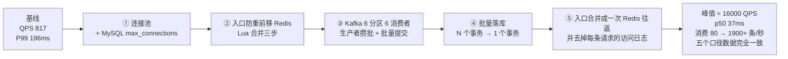

# 秒杀购物平台 · 面试讲解稿

这份稿子的用法：**先背第 1、2 节的框架，再背第 5 节的数字，最后看第 6 节的追问准备**。
第 6 节是面试官最可能深挖的地方，建议对着镜子讲一遍。

## 1. 开场：90 秒讲完项目

> 我做的是一个 Go 语言的电商单体服务，重点做**秒杀**这个高并发场景。
>
> 整体是「注册登录 → 商品 → 购物车 → 下单 → 支付」的常规电商链路，
> 秒杀作为独立页面单独设计。技术栈是 Gin + GORM + MySQL + Redis + Kafka。
>
> 秒杀的核心思路是**把流量挡在数据库外面**：
> 请求进来先在 Redis 里用**一段 Lua 脚本、一次往返**原子地完成「限流 + 活动时间校验 + 请求去重 + 用户限购 + 库存预扣」，
> 扣到了就立刻返回成功并把消息发到 Kafka，真正写 MySQL 的动作交给后台消费端异步做。
>
> 这样 MySQL 就不会被瞬时流量打穿。我做过五轮优化：
> 消费端吞吐从最初约 **80 条/秒** 提升到 **1900 条/秒以上**；
> 入口把 4 次 Redis 往返合并成 1 次之后，单机压测峰值 **约 16,000 QPS**（目标是 1 万），
> 512 并发下 p50 37ms、全部 200、零错误、Kafka 零积压，
> 并且压到最后 `sold`、订单数、去重用户数、去重 `request_id` 数、Redis 剩余库存五个数字完全对得上，没有超卖也没有重复购买。

如果面试官说「展开讲讲」，就进入第 2 节。

## 2. 架构和请求全流程

完整架构图见 `docs/architecture.md`，口头只需要讲这条主线：

```
用户 → Gin(只做鉴权) → Redis(一段 Lua 一次往返：限流+校验+预扣) → Kafka(削峰排队) → 消费端 → MySQL(最终落库)
                             ↑                                                          ↓
                             └──────────── 对账任务每 30 秒兜底 ←─────────────────────┘
```

展开成 5 步：

1. **鉴权**：JWT 解析出 `user_id`，没登录直接 401。
2. **一次 Lua 做完所有判断（最关键的一步）**：整条抢购只跟 Redis 打**一次**交道。
   这一段脚本在 Redis 里原子地做六件事：按用户限流（100 次/秒）、读商品信息、
   读活动时间窗并校验活动有没有开始或结束、判断 `request_id` 是否来过、
   判断该用户是否超限购、扣库存并记录该用户已买数量。
   最后脚本把商品信息**直接 `return` 回来**，省掉一次额外的 `GET`。
   - **为什么必须合成一次**：每一次 Redis 调用都要等一个网络往返，拆开就是 4 个往返；
     隔离基准测出 4 跳的上限只有约 9,000/s，**合并成 1 次后上限约 27,000/s**。
   - **为什么必须用 Lua**：Lua 在 Redis 里单线程原子执行，
     天然避免「先查后扣」之间被并发请求插队导致的超卖。
3. **冷路径兜底**：如果 Redis 里还没有这个商品的缓存（服务刚重启、或者缓存过期），
   脚本会返回「缓存没准备好」，服务就回源 MySQL 读一次商品和活动、写完缓存再重试一次。
   这条路径平时走不到，不影响热路径性能。
4. **异步落库**：预扣成功后把消息发到 Kafka 就立刻返回 200，
   接口返回的订单状态是 `queued`（排队中）。这时 MySQL 里还没有这条记录。
5. **消费端落库**：6 个消费者 goroutine 从 Kafka 批量拉消息，一批最多 200 条，
   在**一个事务**里完成批量查重、批量查限购、按商品汇总扣库存、批量插订单，然后提交消费进度。
   落库后 MySQL 里这条订单的状态是 `pending`。

## 3. 核心设计点（面试官最想听的四个）

### 3.1 怎么保证不超卖

三层防线，性能和正确性分离：

| 层次 | 手段 | 性质 |
| --- | --- | --- |
| Redis Lua | `stock < quantity` 判断后才 `DECRBY`，判断和扣减在同一次原子操作里 | 性能手段 |
| MySQL 条件更新 | `UPDATE ... SET sold = sold + N WHERE id = ? AND sold + N <= total_stock` | 正确性底线 |
| MySQL 唯一索引 | `request_id` 唯一、`(item_id, user_id)` 唯一 | 正确性底线 |

**关键话术**：前两层是「让大部分请求根本到不了数据库」，
第三层是「就算前面全失效，数据库也绝不会写错」。这两件事必须分开设计，
不能指望数据库又能扛并发又不出错。

### 3.2 怎么保证幂等（同一请求不重复下单）

- **入口层**：`request_id` 在 Redis 里存一个标记（TTL 24 小时），
  存在就直接返回「重复的 request_id」，不再往下走。
- **落库层**：MySQL `seckill_orders.request_id` 是唯一索引，
  即使 Redis 标记因为某种原因丢了，重复插入也会被数据库拒绝。
- **批内去重**：同一批 Kafka 消息里如果出现相同的 `request_id`，
  在处理前就判成重复，避免撞唯一索引导致**整批**插入失败。

三层环环相扣，任何一层单独失效都不会出错。

### 3.3 怎么保证消息不丢、不重复

- **不丢**：消费端严格「先处理业务、再 `Commit` 消费进度」。
  如果先提交再处理，进程一崩消息就真丢了；反过来最多是重复消费一次，而重复是幂等的。
- **不重复造成错误**：重复消息落到 MySQL 会被唯一索引挡住，
  消费端把它归类成 `duplicate`。
  **注意：重复消息绝对不能回补 Redis**——它代表 MySQL 里已经有这条订单，
  说明当初那次扣减是真实成交的，再回补一次库存就凭空多出来，等于超卖。
- **兜底**：整批落库失败时，`compensate` 会把 Redis 预扣的库存和用户购买数还回去；
  万一补偿也失败，还有 30 秒一次的对账任务用 MySQL 的账本把 Redis 覆盖回正确值。

### 3.4 为什么用 Kafka，不用别的消息队列

| 对比项 | Kafka（当前选择） | RabbitMQ | Redis List / Stream |
| --- | --- | --- | --- |
| 吞吐 | 单机十万级，天然支持高吞吐 | 万级，更擅长复杂路由 | 十万级但功能少 |
| 顺序性 | **按分区保证顺序**，可以按 `itemID` 做 key 让同一商品的请求进同一分区 | 队列内顺序，但并发消费时顺序难保 | 顺序可控但要做很多自己实现 |
| 持久化 | 磁盘顺序写，可重复消费（改 offset） | 支持，但堆积能力弱 | Redis 是内存，堆积有风险 |
| 水平扩展 | **加分区就能加并行度**，这正是本项目消费端从 1 个消费者扩到 6 个的关键 | 加消费者即可，但单队列上限受限 | 需要自己分片 |
| 适合场景 | 削峰、日志、流式 | 业务解耦、延时队列、复杂路由 | 简单队列 |

**为什么这个项目选 Kafka**：秒杀的特征是**瞬时洪峰 + 短时间大量消息**，
需要「能存住、能堆积、能加消费者并行追」。
卡夫卡的分区模型正好能让 6 个消费者并行消费同一个 topic，
这是本项目消费端吞吐能提升 20 倍以上的结构性前提。

### 3.5 系统怎么自己发现异常（阶段 6.3）

**一句话**：把「人盯屏幕」换成「系统按基线自己判断」。

- 每 2 秒采一次样，把累计值（一共处理了多少请求）换算成速率（每秒多少），
  再和**最近 30 个采样窗口的基线**比：偏离超过 4 倍标准差、并且连续 3 个窗口都越线才报警。
  为什么非要「连续 3 个窗口」：单个窗口的毛刺太常见，不设这道闸就会天天误报，最后没人看。
- 报出来的是**人话 + 排查方向**，不是一串数字。实测时系统自己打出的是：
  「QPS 冲到 4705/s，平时约 0.0/s（波动 ±0.0），越过门槛 500/s……先看限流是否生效、
  Redis 扣减是否正常、Kafka 有没有开始积压」，22 秒后又自己打出恢复事件（峰值 5257.7）。
- 盯四个指标：QPS（流量突增）、5xx 错误率（真的坏了）、Kafka 积压、在途订单积压。
  后两个其实是同一件事的两个视角——Kafka 那边是「消息还没被消费者取走」，
  本进程这边是「取走了但还没落库」。两个都涨说明消费端真追不上了。
- **为什么不用大模型**：告警要能离线复现、要能解释「凭什么报这一次」，
  统计方法（均值 + 标准差 + 连续确认）就够了，而且没有调用失败和费用问题。
  压测报告工具 `cmd/benchreport` 也是同一个取舍：瓶颈线索用写死的阈值判断，
  宁可文案死板，也要保证每次跑出来的结论一致、可核对。

**做这块时踩到的四个坑，全都是很好的面试素材**（细节比结论更值钱）：

1. **展示的数要和参与判断的数是同一个**。告警门槛实际取「基线 + 4σ」和「绝对下限」里更严的那个，
   但文案里写的还是「基线 + 4σ」。冷启动时基线是 0，于是报出「越过门槛 0/s」这种自相矛盾的话。
2. **比率的分子分母必须同一时刻、同一口径**。4xx 拒绝率一度算出 **100.43%**：
   分子是「请求结束时」才 +1 的 4xx 计数，分母是「请求进来时」就 +1 的总请求数，
   同一瞬间分子可能大于分母。修法是加一个「已完成请求数」计数器，所有比率的分母一律用它。
3. **事件里要报「状态量」，不能报「瞬时量」**。告警恢复事件里的「峰值」原本报的是最后一个窗口的值（586），
   而真实峰值是 5257——因为告警期间根本没记录峰值。修法是在告警状态里维护 `Peak`，恢复时一并输出。
4. **给机器看的顺序和给人看的顺序经常不一样**。`/metrics/alerts` 返回的事件是最新在前，
   报告直接照抄，读起来就是倒着的。展示层要单独排一次序。

## 4. 优化故事（这是最加分的部分）

不要把优化讲成「我调了几个参数」，要讲成**「我不断找到当前真正的瓶颈并解决它」**：



### 第 ① 轮：先把「连接被打爆」解决掉

- **现象**：并发一上到 500 就开始出现 500，日志里是 `dial tcp 127.0.0.1:3307: connect: connection refused`。
- **原因**：GORM 没设连接池上限，MySQL 默认 `max_connections` 只有 151，连接一多直接被拒。
- **做法**：`SetMaxOpenConns(100)`、`SetMaxIdleConns(50)`、`SetConnMaxLifetime(1h)`，同时把 MySQL 提到 500。
- **结果**：连接拒绝消失，c=100 时 QPS 从 817 提升到 1116。
- **但**：c 继续加到 1000，QPS 反而降了、延迟涨到 1.3 秒——说明瓶颈转移了。

### 第 ② 轮：把数据库从入口链路上「请出去」

- **现象**：连接池打满，但慢查询一个都没有；一查代码发现秒杀入口在 Redis 之前先查了两次 MySQL
  （一次查 `request_id` 是否重复，一次查用户是否买过）。
- **原因**：这两次查询在秒杀场景下是纯浪费——Redis 里明明可以判。
- **做法**：把「请求去重 + 限购判断 + 库存预扣」合并成一段 Lua 脚本，一次 Redis 往返全部搞定。
- **结果**：c=100 时 QPS 从 1116 提升到 1445（+30%），c=500 时从 1698 到 2101。
- **注意点**：合并成一次原子操作还有个额外好处——**避免「先查后扣」之间被并发请求插队导致的超卖**。

### 第 ③ 轮：加并行度（Kafka 侧）

- **现象**：入口不查库了，但活动一结束还是有一堆消息积压，消费追不上。
- **原因**：只有 1 个消费者、1 个分区，而且生产者一条一条发、消费端一条一条提交，
  网络往返次数太多。
- **做法**：
  - topic 从 1 个分区扩到 **6 个分区**，启动 **6 个消费者**（同一个消费组）；
  - 生产者开启攒批：`BatchSize=100`、`BatchTimeout=10ms`；
  - 消费端改成 `FetchBatch` 批量拉、批量 `Commit`；
  - 关键细节：把 `CommitInterval` 设成 0 **关掉后台自动提交**，改成业务处理成功后手动提交，
    否则会出现「消息还没处理，offset 已经被自动提交了」的丢消息风险。
- **结果**：消费端吞吐上来了，Kafka 不再持续积压。

### 第 ④ 轮：批量落库（本轮重点，也是最能体现深度的一轮）

- **现象**：Kafka 侧优化完，消费速率还是只有约 **80 条/秒**。查监控发现
  `Innodb_row_lock_waits` 几乎等于 `Com_commit`——**每次提交都在等行锁**，
  平均每次等 **65 毫秒**。
- **原因**：**一条消息一个事务**，而 6 个消费者处理的都是同一个商品，
  每个事务里都有一句 `UPDATE seckill_items SET sold = sold + 1 WHERE id = ?`。
  MySQL 对同一行同一时刻只允许一个事务修改，于是 6 条流水线全挤在一个收银台前排队。
  **瓶颈从 Kafka 转移到了 MySQL 的行锁上。**
- **做法**：把「N 条消息 = N 个事务」改成「**N 条消息 = 1 个事务**」：

| 原来（每条消息各来一次） | 现在（整批一次） |
| --- | --- |
| N 次 `SELECT ... WHERE request_id = ?` | 1 次 `WHERE request_id IN (...)` |
| N 次 `SELECT ... WHERE user_id = ? AND item_id = ?` | 每个 itemID 一次 `IN (...)` |
| N 次 `UPDATE ... SET sold = sold + 1` | 每个 itemID 一次 `SET sold = sold + N` |
| N 次单条 `INSERT` | 1 次多值 `INSERT ... VALUES (...),(...)` |
| N 次行锁竞争 | **1 次行锁竞争** |

- **结果**（15379 条消息的一轮压测）：

| 指标 | 优化前 | 优化后 |
| --- | --- | --- |
| `Com_commit` 事务提交次数 | 1057 次 / 1057 条消息 | **196 次 / 15379 条消息**（约 78 条/事务） |
| `Innodb_row_lock_waits` 行锁等待 | 1057 | **90** |
| 消费速率 | 约 80 条/秒 | **1900+ 条/秒** |

- **额外踩到的坑**：批量插入时，同一批里如果有两条相同的 `request_id`，
  会撞唯一索引导致**整批**插入失败回滚。所以在处理前先做了一次「批内去重」，
  把同批重复的请求提前判成 `duplicate`。

### 第 ⑤ 轮：把入口的 4 次 Redis 往返合并成 1 次（最能体现深度的一轮）

- **现象**：消费端已经不积压了（Kafka LAG 长期为 0），但入口 QPS 就卡在约 5,900 上不去。
- **定位**：先用隔离基准（不经过 HTTP，直接打 Redis）量出
  「4 次顺序往返」的上限约 9,000/s、「合并成 1 次」的上限约 27,000/s，
  和实测的 5,900 正好对得上——**瓶颈就是这 4 个网络往返**。
- **做法**：把「限流计数 → 读商品信息 → 读活动时间窗 → 校验活动时间 → 幂等判重 →
  限购判断 → 扣库存」全部写进同一个 Lua 脚本，脚本把商品信息直接 `return` 回来，
  连那次 `GET` 都省掉；限流也从中间件搬进脚本，维度从 IP 改成用户
  （抢购必须登录，按用户限流反而更准，换 IP 也躲不掉）。
  缓存没命中时脚本回一个 `-5`，服务回源 MySQL 填缓存后重试一次。
- **结果**：

| 并发 VU | 优化前 QPS | 优化后 QPS | 提升 |
| --- | --- | --- | --- |
| 64 | 5,600 | 10,464 | 1.87× |
| 256 | 6,814 | **16,096** | 2.36× |
| 512 | 6,668 | 14,855 | 2.23× |

  峰值 **约 16,000 QPS**，512 VU 下 p50 从 84.7ms 降到 **37.1ms**，
  各档全部 0 错误、0 限流；压完之后 `sold`、订单数、去重用户数、去重 `request_id` 数、
  `SUM(quantity)`、Redis 剩余库存这几个数字完全一致。
- **额外收获**：整条链路收进一段脚本之后，**原子性反而更强了**
  ——原来是「先读缓存、再扣库存」两次操作，中间理论上还能插进别的请求。
- **下一个天花板在哪**：用 pprof 采了 CPU profile（这是本轮顺手加的能力，
  设 `ENABLE_PPROF=1` 才会开），45% 的时间花在阻塞式 socket 系统调用，
  42% 是 `net.(*conn).Write`（把 HTTP 响应写回去），业务代码几乎不上榜。
  所以再往上不是改代码的事，而是部署层面的事。

### 五轮优化总览

| 轮次 | 瓶颈 | 解决手段 | QPS |
| --- | --- | --- | --- |
| 基线 | MySQL 连接被拒 | — | 817 |
| ① | 连接池 / 最大连接数 | 连接池上限 + MySQL 500 连接 | 1116 |
| ② | 入口的两次 MySQL 查询 | 防重前移 Redis，Lua 合并三步 | 1445 |
| ③ | 消费并行度不足 | 6 分区 + 6 消费者 + 批量收发 | — |
| ④ | **MySQL 行锁竞争** | **整批一个事务** | 约 2000 |
| ⑤ | **入口的 4 次 Redis 往返** | **合并成一段 Lua，只剩 1 次往返** | **约 16000** |

## 5. 数据手册（建议背下来）

**压测结果（批量落库优化后）**

| 压测 | 请求数 | QPS | P99 | Kafka LAG |
| --- | --- | --- | --- | --- |
| 并发 100 / 8 秒 | 15379 | 1915 | 126ms | 归零 |
| 并发 200 / 10 秒 | 20228 | 2012 | 233ms | 全程 0 |
| 并发 600 / 15 秒 | 29236 | 1921 | 620ms | 峰值 368，约 3 秒追平 |

三次压测全部返回 200，**零错误**。

**压测结果（入口合并成一次 Redis 往返之后，k6）**

| 并发 VU | QPS | p50 | p95 | p99 | 错误 / 限流 |
| --- | --- | --- | --- | --- | --- |
| 64 | 10,464 | — | — | — | 0 / 0 |
| 128 | 14,005 | — | — | — | 0 / 0 |
| 256 | **16,096** | — | — | — | 0 / 0 |
| 512 | 14,855 | 37.1ms | 56.7ms | 71.8ms | 0 / 0 |
| 1024 | 15,212 | — | — | — | 0 / 0 |

（「—」表示这一档只导出了 QPS，没有单独记录分位延迟；
同一档优化前的 p50 是 84.7ms，改完降到 37.1ms。）

**一致性核对（多轮压测累积后）**

| 项目 | 数值 |
| --- | --- |
| 秒杀商品总库存 | 200000 |
| MySQL `sold` | 105092 |
| MySQL 订单数 | 105092 |
| MySQL 去重用户数 | 105092 |
| Redis 剩余库存 | 94908 |
| `200000 - 105092` | 94908 |

**结论**：卖出的件数 = 订单数 = 去重用户数，剩余库存正好等于总库存减卖出件数。
没有超卖，没有重复购买，Redis 和 MySQL 最终一致。

**一致性核对（合并 Redis 往返之后，商品 `id=17`，总库存 5,000,000，每人限购 1 件）**

| 项目 | 数值 |
| --- | --- |
| MySQL `sold` | 2,183,529 |
| MySQL 订单数 | 2,183,529 |
| MySQL 去重用户数 | 2,183,529 |
| MySQL 去重 `request_id` 数 | 2,183,529 |
| MySQL `SUM(quantity)` | 2,183,529 |
| Redis 剩余库存 | 2,816,471 |
| `5000000 - 2183529` | 2,816,471 |

Kafka 消费组 6 个分区 **LAG 全部为 0**，全程日志 0 panic、0 补偿失败。

**其它可以报的数字**

- `/seckill/activities`（纯读接口）单机做到 **10166 QPS**，说明读路径本身很轻。
- 秒杀入口最初的基线是 **817 QPS**，P99 196ms。
- 入口优化的前后对比：**5,907 QPS（4 次 Redis 往返）→ 约 16,000 QPS（1 次往返）**。
- Redis 隔离上限：4 次往返约 **9,000/s**，合并成 1 次约 **27,000/s**。
- `/health`（不碰任何业务逻辑）同一台机器上峰值约 **64,000/s**，用来证明「瓶颈不是 HTTP 入口」。
- 单条链路隔离基准：只打 Redis 约 **34,000/s**；Redis + Kafka 全链路约 **30,500/s**；
  只发 Kafka 约 **86,200/s**。说明 Kafka 不是瓶颈。

**可观测能力（阶段 6.3）相关的数字**

- 告警实测（256 VU / 20 秒）：`15:40:05` 系统自动报「突发流量」（QPS 4705/s、门槛 500/s、
  比基线高 4 倍标准差以上），`15:40:27` 自动报恢复（持续 22 秒、峰值 5257.7/s）。
- 全程 5xx 峰值 **0%**、Kafka LAG 峰值 **0**、在途订单峰值 **0** —— 说明这套观测是在
  「系统没出事」的情况下也不会误报（压测流量涨了 800 倍才报的）。
- 观测的代价：同一条件 A/B（256 VU / 20 秒），加观测前 112,631 请求 / 平均 47.7ms / p99 60.0ms，
  加观测后 108,353 请求 / 平均 QPS 4,918 / p99 65.18ms —— **QPS 没有可见下降**。
- 采样间隔 2 秒、保留 900 个样本（约 30 分钟）；`/metrics/history` 一次可能返回几百 KB。

## 6. 高频追问准备

### Q1：Redis 挂了怎么办？

分三种情况答：

1. **Redis 挂 → 秒杀入口直接不可用**（返回错误而不是放行）。
   这是有意为之：Redis 是预扣的唯一入口，它不在了就不能判断库存和限购，
   此时**宁可拒绝服务也不能放请求进 MySQL**，否则就是超卖。
2. **降级方案**：可以让秒杀接口返回「系统繁忙，请稍后再试」，
   同时普通下单链路不受影响（普通下单走的是 MySQL 事务，不依赖 Redis 预扣）。
3. **数据安全**：Redis 里存的库存是可以**从 MySQL 重新算出来**的
   （`realStock = total_stock - sold`），所以 Redis 整机丢失也不会造成账目错误，
   重启后用对账任务灌一次即可。**这就是「Redis 只做预扣、MySQL 才是账本」的意义。**

追加一句加分：库存和限购这类数据不怕丢（可重建），
但 `request_id` 幂等标记丢了会导致重复请求可能被放行，
不过 MySQL 的唯一索引仍然会挡住，所以整体依然安全。

### Q2：Kafka 堆积怎么办？

按「应急 → 短期 → 长期」三层答：

1. **应急**：加分区 + 加消费者。本项目已经把消费者做成可配置的数组
   （`kafkaConsumerCount`），扩容就是改个数字重启。
2. **短期**：把消费端的批量参数调大（现在是 `consumeBatchSize = 200`），
   让每次事务处理更多消息，减少事务和网络往返次数。
3. **长期**：看是不是热点商品太集中——所有消息都是同一个 `itemID`，
   那再怎么加消费者也绕不开 MySQL 同一行的锁。这时要考虑
   **库存分桶**（把一个商品的 1000 个库存拆成 10 个桶，每个桶独立扣减），
   或者**在 Redis 里就把库存扣完**、MySQL 只做批量归档。

还要补一句：**堆积本身不丢消息**，Kafka 是磁盘持久化的，
只要有足够磁盘就能撑住，真正要防的是「堆积到最后活动结束了还没写完」。

### Q3：库存不一致怎么办？

1. **正常情况不会不一致**：Redis 预扣成功才发 Kafka，
   消费端失败会 `compensate` 回补 Redis。
2. **补偿也失败**：靠 **30 秒一次的对账任务**兜底，
   用 MySQL 的 `total_stock - sold` 重新算一遍 Redis 库存并覆盖。
3. **为什么以 MySQL 为准**：因为 MySQL 是唯一的「账本」，
   Redis 只是「挡箭牌」。挡箭牌坏了可以重做，账本错了才是真事故。
4. **会不会误判**：这里有一个真实的坑，本项目已经踩过并修掉了。
   Redis 已经预扣、MySQL 还没落库时，如果此刻正好触发对账，
   对账会拿偏小的 `sold` 反推库存，把已经卖掉的库存**加回 Redis**，
   于是多放出名额（库存 100 件的活动里就是超卖）。
   实测过：压测结束时 Kafka 里还剩 10,634 条没消费完，正好撞上一次对账，
   Redis 剩余库存比 MySQL 账本多出 10,634。
   **修法**是给队列加两个信号：在途订单计数、每个消费者是否追平过；
   对账只在「没有订单在途、且消费端已经追平」时才允许覆盖 Redis，
   有在途订单就整轮跳过并打日志。
   修复后重跑同样的爆发流量，`Redis剩余 - (总库存 - 已售)` 全程为负（最低 -35,283），
   流量停下后自动收敛到 0。

### Q4：为什么不用分布式锁，而是用 Lua？

Lua 在 Redis 里是**单线程原子执行**的，
一段脚本执行期间不会有别的命令插进来，所以「读库存 → 判断 → 扣库存」天然原子。
分布式锁要额外做加锁、超时、续期、释放，还容易因为锁超时出现两个线程同时进临界区，
复杂度高、性能还更差。**能用一个原子操作解决的事，就不要引入锁。**

### Q5：为什么一开始是单体？后来又怎么拆的？

**分两层答：先讲「当初为什么该保持单体」，再讲「后来按什么顺序真的拆了」。**

- 当初的取舍：用户量还没到需要拆的规模，单体部署简单、调试方便、没有分布式事务。
  而且代码里的模块边界本来就是按微服务切的（每个模块独立的 model/repository/service/handler，
  模块之间只通过 service 接口调用），**随时可以按边界拆出去**，不必提前付拆分的成本。
- 后来怎么拆：阶段 13 先把网关**旁路**立起来（8081 转发给 8080，业务代码一行不改），
  阶段 14 搬出 user-service，阶段 15 搬出 seckill-service；每一步都单独验收，
  单体保留 `USER_MODULE` / `SECKILL_MODULE` 两个开关随时让位。
- 真拆之后补了什么、踩了什么坑：鉴权下沉（网关验一次、下游信 `X-User-Id`）、trace 全程透传、
  幂等与对账，而且**秒杀热路径一跳都没加**。踩坑清单（僵尸消费者、`Director`/`Rewrite` 二选一、
  白名单前缀匹配、进程内计数器跨进程失效……）见 `docs/microservices.md` 第 11 节。
- 明确**不做**的事：不引入 2PC / TCC / Seata，也不上服务发现和配置中心
  （服务数量固定，环境变量 + 固定端口足够），理由见 `docs/microservices.md` 第 9 节。

### Q6：QPS 到 1 万了吗？怎么做到的？

**按「先测量、再动手」的顺序讲**：

「到了。单机峰值 **约 16,000 QPS**，是 1 万目标的 1.6 倍；
512 并发下 p50 37ms、p95 57ms、p99 72ms，全部 200、0 错误。

过程分四步：

第一步先确认瓶颈在哪。消费端不积压（Kafka LAG 长期为 0），说明压力已经不在下游；
再用同一个脚本压 `/health` 做对照，峰值约 **64,000/s**——
HTTP 入口离天花板还差得远，那 5,900 是秒杀业务链路自己造成的。

第二步把这条链路拆开量。不经过 HTTP，直接用隔离基准打 Redis：
一次秒杀要做 4 次顺序 Redis 往返（限流 1 次 + 商品信息读 1 次 + 活动时间读 1 次 + Lua 预扣 1 次），
**4 跳的上限约 9,000/s；合并成 1 次往返后上限约 27,000/s**。
实测卡在 5,900，正好被这个 9,000 压住，对得上。

第三步才动手改：把限流、读商品信息、校验活动时间、幂等判重、限购、扣库存全部写进一段 Lua，
脚本把商品信息直接 `return` 回来，连那次 `GET` 都省掉；限流从中间件搬进脚本，
维度从 IP 改成用户（抢购必须登录，按用户更准）。缓存没命中时脚本回一个 `-5`，
服务回源 MySQL 填缓存后重试一次。
改完实测提升 1.9~2.4 倍，峰值到 1.6 万；而且**整条链路收进一段脚本之后，原子性反而更强了**。

第四步看下一个天花板：用 pprof 采 CPU profile，45% 的时间在阻塞式 socket 系统调用、
42% 在 `net.(*conn).Write`（把 HTTP 响应写回去），业务代码几乎不上榜。
所以再往上不是改代码的事，而是部署层面（Linux/epoll、`GOMAXPROCS` 调参、长连接、单机多实例）。

这里有个贯穿始终的判断依据：**看 LAG**。如果消费端有积压，说明瓶颈在消费端；
LAG 一直是 0 而 QPS 上不去，说明瓶颈在入口。我这几轮优化就是靠这个决定往哪个方向使劲的。」

### Q7：怎么保证消费端重启后消息不丢？

- 消费进度存在 Kafka 的消费组里，重启后从上次提交的 offset 继续。
- 因为「先处理业务再提交」，最坏情况是重复消费最后一批消息，
  而重复由唯一索引兜住，不会产生错误数据。

### Q8：限流为什么放在秒杀路由，而不是全局？为什么又搬进了 Lua？

因为限流的目的是**保护秒杀这个最脆弱的链路**，全局限流会误伤商品浏览、订单查询这些正常流量。

至于抢购的限流为什么不放在中间件里：**中间件的限流计数本身就是一次独立的 Redis 往返**，
而这一轮优化的核心正是「把入口的往返次数从 4 降到 1」，
外面再套一层 Redis 限流中间件，等于把刚省下来的那一次又加回去。
所以抢购的限流搬进了同一个 Lua 脚本，和扣减共用那一次往返；
代价是维度从 IP 变成了用户——抢购接口必须登录，按用户限流其实更准
（同一个人换 IP 也躲不掉）。

秒杀的**管理类接口**（建活动、建商品、查活动）仍然走 IP 限流中间件
（单 IP 100 次/秒），因为那些接口本来就不在压测热路径上，多一次往返无所谓。

补充（阶段 10）：**窗口本身也从「固定窗口」换成了「滑动窗口」。**
老写法是 `INCR ratelimit:seckill:user:<用户ID>:<窗口号>`，窗口号 = `当前毫秒 / 1000`，
等于把时间切成一个个「自然秒」。这有个人尽皆知的洞：同一个用户在第 1 秒的最后 10 毫秒
打 100 次、第 2 秒的头 10 毫秒再打 100 次，两次落在**不同的窗口**里、各自都「没超」，
可现实里这 20 毫秒内已经放过了 200 次——上限被放大成 2 倍。
新写法是**不数数，而是把每次放行的时刻记下来**：`ZADD <限流 key> <放行时刻毫秒> <成员>`，
判断时先 `ZREMRANGEBYSCORE` 删掉已经滑出窗口的旧记录、再 `ZCARD` 数剩下几条，
依据从「现在是第几个固定窗口」变成「最近 1000 毫秒内到底放行过几次」，
没有窗口翻页，也就没有那个边界瞬间。key 也随之简化成
`ratelimit:seckill:user:<用户ID>`（不按窗口编号分 key），靠 `PEXPIRE` 自然过期。
验证方法很直观：同一个用户，第一批 110 个请求打在某自然秒的 500ms 处、
第二批打在下个自然秒的 60ms 处，两批只隔约 300 毫秒——
**固定窗口两批各放 100、合计 200；滑动窗口 A 批放满 100、B 批全拒（0）。**
三个容易写错的细节：① 只有**放行**的请求才记进窗口，被拒的也记的话窗口会被自己的
拒绝记录越填越满，变成「越限封得越久」；② 成员不能只用毫秒时间戳，同一毫秒里的并发
请求会互相覆盖、计数偏少，热路径用 `request_id`（天然唯一），通用限流器用
「毫秒-进程内自增序号」；③ 抢购热路径**没有**复用那个通用限流器——那会多出一次
独立 Redis 往返，正好把第 ⑤ 轮省下来的那次还回去，所以热路径保留自己嵌在大脚本里的限流。

### Q9：`pending` 状态是什么意思，用户体验怎么保证？

`pending` 表示「名额已锁定，订单正在落库」。
因为 Redis 扣减成功基本等于一定落库（除非数据库整体不可用），
所以这个承诺是可信的。用户可以拿到订单号去查详情、或者走支付流程。

`pending` **不是终点**：它带一个付款时限（默认 15 分钟），到点还没付款，
后台的「超时关单」任务会把它改成 `cancelled`、并把占用的库存还回商品池（阶段 9，见 Q11）。
用户侧的感受是：秒杀页在「已抢到」时会显示一个付款倒计时，
倒计时走完页面会自动翻成「超时未付款，订单已自动取消」，
同时剩余库存的数字涨回去。**库存不会被抢到不付钱的人永久占住。**

### Q10：告警为什么要设「绝对下限 + 相对基线 + 连续确认」三层？

只设绝对阈值（比如 QPS > 5000 就报警）在秒杀场景会失效：凌晨没流量时，
QPS 从 0 涨到 50 也是「暴涨 50 倍」，但完全不值得报警。
只设相对基线又会漏掉「基线本来就高、再涨一点就出事」的情况。三层叠起来正好互补：

| 层 | 作用 | 本项目取值 |
| --- | --- | --- |
| 绝对下限 `Floor` | 太低的值连看的必要都没有 | QPS 500/s、5xx 1%、积压 1000 条 |
| 相对基线 `Sigma` | 只有明显偏离「平时」才算异常 | 最近 30 个窗口，超过 4 倍标准差 |
| 连续确认 `Consecutive` | 滤掉单个窗口的毛刺 | 连续 2 ~ 3 个窗口越线才报 |

最终门槛取「基线 + Nσ」和 `Floor` 里**更严的那个**；
恢复也要连续几个窗口回到基线附近才算，避免在门槛附近来回横跳、反复报警。

### Q11：用户抢到了却一直不付款，库存怎么办？

**一句话回答**：订单带付款时限，到点自动关单并把库存还回商品池；
实现上是「Redis 延时队列（正常路径）+ MySQL 兜底扫描（安全网）」两条路，
并且关单必须「先改 MySQL 再改 Redis」、幂等要做两层。

这不是一个可以跳过的功能。少了它，「抢到不付钱」就等于**永久占住库存**：
用脚本把 1000 件全抢下来一直不付款，商品就再也卖不出去了。
电商里这叫「占库存」，是真实存在的攻击手法。

**为什么用延时队列，而不是给每笔订单起一个定时器**（`time.AfterFunc`）：

| | 每笔订单一个定时器 | Redis ZSET 延时队列 |
| --- | --- | --- |
| 进程重启 | **定时器全丢**，那些订单永远不会被关掉 | 队列在 Redis 里，重启后照常处理 |
| 几万笔订单 | 几万个定时器对象，内存和调度都是负担 | 一条 `ZADD` 一条记录，天然有序 |
| 多实例部署 | 每个实例只管自己内存里那份，无法统一 | 所有实例读同一个队列，天然共享 |

具体做法是把「到期时间」存成 ZSET 的 score：

```
ZADD seckill:orders:expire <到期时间戳> <request_id>
ZRANGEBYSCORE seckill:orders:expire -inf <当前时间戳> LIMIT 0 200
```

第二条命令就是「捞出所有已经到点的订单」。ZSET 的成员天然去重，
所以「同一笔订单被写进队列两次」不会导致重复关单；
用 `request_id` 当成员而不是订单主键，处理时不必先知道订单号就能判断。

**为什么还要一条 MySQL 兜底扫描**：延时队列在 Redis 里，而 Redis 可能丢数据
（重启没落盘、内存淘汰、网络问题），更常见的是「订单刚写进 MySQL、进程就崩了，
还没来得及写队列」——这笔订单的定时任务凭空消失。
所以每 5 秒再回 MySQL 问一次「有没有状态还是 `pending`、但早就过了时限的单」。
**任何依赖外部组件的定时任务，都要有一份权威数据能被定期回查**，否则就是单点。

**两个必须答对的细节**（面试官很爱追这两处）：

1. **顺序：先改 MySQL，再改 Redis。**
   反过来先加 Redis 库存、再改 MySQL 时失败了，库存就凭空多出一份——那是**超卖**，比少卖严重得多。
   正着来中途失败只是「Redis 暂时少一份库存」，属于**少卖**，下一轮重试或对账都能补上。
   一句话：**朝安全的方向失败。**
2. **幂等要做两层。**
   MySQL 层是条件更新 `UPDATE ... WHERE id=? AND status='pending'`，
   只有 `RowsAffected = 1` 的那次调用才算真的关单。
   Redis 层是 `SETNX seckill:order:{requestID}:restored` 抢标记，只有第一个调用者真的回补。
   为什么 MySQL 那层不够？因为「关单 → 用户重新抢购 → 回补又被重试执行一次」这个场景，
   按「用户已买数够不够扣」是判断不出来的，库存会真的变大。

**还踩到两个真实的坑，都很适合当谈资**：

- **兜底扫描必须有时限**。库里当时躺着 440 万条压测遗留的待付款订单，
  扫描一上线就把它们全当成「超时」，每 5 秒啃 200 条要跑几十个小时、日志也被刷爆。
  定论：兜底扫描的职责是「延时队列漏掉的那几笔」，
  不是「修复停机几个月的历史数据」，后者属于运维脚本的活。
- **扫描没索引就是一场事故**。加上「只扫最近 6 小时」的条件后，
  没有索引时它退化成**全表扫描**：6 小时窗口里一行都没有，
  MySQL 只能一行行扫完 440 万行才敢说「没找到」——实测每次 **1.6~1.8 秒**，
  而扫描每 5 秒一轮，等于常年白烧一个 CPU 核去证明「啥也没有」。
  修法是加 `(status, created_at)` 复合索引，并把排序从 `ORDER BY id` 改成
  `ORDER BY created_at, id`：排序字段和索引顺序一致，才能顺着索引取前 200 条就收工。
  改完执行计划从 `type: index` 变成 `type: range`（`rows: 1`）。

**一个容易被忽略的连带影响**：`seckill_items.sold` 的语义要重新定义成
「**还没被取消的订单占用的库存**」（含 `pending`，不含 `cancelled`）。
因为对账任务是用「`total_stock - sold`」反推 Redis 库存的，
关单时如果不把 `sold` 一起减回去，下一次对账会按「这一份还占着」重新算，刚还的库存又被吞掉。

### Q12：网关为什么用 `Rewrite` 不用 `Director`？拆微服务这段踩过哪些坑？（阶段 13~16）

**先说为什么先立网关**：不管拆不拆，秒杀热路径一跳都不能加。
阶段 13 只是把网关**旁路**地立在新端口 8081 上、转发给原单体 8080，
`cmd/server/main.go` 一个字没改，所以压测结果、演示页面完全不受影响
（阶段 14/15 才把 user、seckill 搬成独立进程，用的都是这套路由表，只是换了上游地址）。
先把「哪个路径归哪个服务、谁需要登录、请求编号是什么、转给谁」这四件事定下来，
以后把某个模块搬成独立进程就只是「换个上游地址」（`GATEWAY_UPSTREAM_USER=http://127.0.0.1:8082`）。

**为什么用 `Rewrite`**：Go 官方从 1.20 起就把 `Director` 标记为「将来会被 `Rewrite` 取代」。
两者的实质差别是：`Director` 直接在**进来的那个请求**上改；
`Rewrite` 拿到的是一个 `httputil.ProxyRequest`，里面 `In`（进来的请求）和 `Out`（要发出去的请求）是分开的，
改 `Out` 不会污染 `In`。附带好处是：用 `Rewrite` 时反向代理会**先替我们删掉**客户端自己传的 `Forwarded` / `X-Forwarded-*`，
伪造来源这件事默认就被堵住了。

**坑 1（最要命）：`Director` 和 `Rewrite` 只能有一个。**
`httputil.NewSingleHostReverseProxy()` 会**默认帮你填一个 `Director`**（它会做 URL 拼接、还会删 hop-by-hop 头）。
我们改用 `Rewrite` 之后没把默认的 `Director` 清掉，于是两个同时存在，
`net/http/httputil` 直接拒绝工作，每个请求都报：

```
ReverseProxy must have exactly one of Director or Rewrite set
```

症状是**所有**请求一律 502「上游服务不可用」，而后端其实活得好好的——非常有误导性。
修法只有一行：`proxy.Director = nil`。
**要点是「换成 Rewrite」不是「加上 Rewrite」，而是「换掉 Director」**。

**坑 2：白名单是全等比较还是前缀匹配。**
网关要替所有服务做鉴权，就得知道哪些接口本来不需要登录。
白名单里写的是 `/shop`，但演示前台实际请求的是 `/shop/data`、`/shop/seckill`……
最早用 `slices.Contains` 做**全等**比较，结果是只有一字不差的 `/shop` 能过，其它全被拦成 401，
演示前台整片打不开。改成 `strings.HasPrefix` 前缀匹配才是对的。
同理 `/healthz` 必须显式进白名单，否则按「默认要登录」的保守默认值会被自己的健康检查拦下来。

**坑 3：最长前缀匹配记错了比较对象。**
路由表里 `/shop` 归 shop 服务、以后可能加 `/shop/my` 这种更专的规则，所以要取「最长的那个前缀」。
当时的写法是把**请求的完整路径**存进了「当前最长」变量，于是下一次比较变成 `len(path) > len(path)`、
永远为 false，整个函数退化成「第一条命中的赢」——这种 bug 换个顺序就复现或消失，非常难查。
正确做法是比 `route.Prefix` 的长度，命中就整条路由赋值过去。

**坑 4：链路追踪的编号在中间被换掉。**
网关的 trace 中间件应该是「请求头里有就沿用、没有才新生成」。
写成了「先 `if` 判断一下，紧接着又无条件 `NewID()`」，那个 `if` 等于白写——
上游传进来的编号每次被丢掉，链路每经过一跳就换一次号，**追踪直接断掉**。
这类「判断写了但没生效」的死代码，编译器不会报，只有把链路真跑一遍才看得出来。

**坑 5：`*gin.Context` 能当 `context.Context` 用，但不该这么用。**
`WithID(c, id)` 里的 `c` 是 `*gin.Context`，它**碰巧也实现了 `context.Context` 接口**，所以能编译过。
但请求真正携带的 context 是 `c.Request.Context()`（反向代理转发时取的就是它），
语义上必须传后者，否则「传进去了但下游取不到」。

**顺带说一个安全细节**：网关是唯一有权写 `X-User-Id` 的地方，但公开路径是直接放行的，
如果不清客户端的 `X-User-Id`，客户端就能伪造一个原样转发给下游。
阶段 13 当时下游还不看这个头，所以没出事；阶段 14/15 下游真的改成「信网关」之后，这就是一个能冒充别人的洞。
所以在鉴权中间件的**第 0 步**就 `Header.Del`。另外刻意**不调用** `req.SetXForwarded()`：
下游取客户端 IP 用的是 `c.ClientIP()`，它读 `X-Forwarded-For` 的**第一段**，
而 `SetXForwarded()` 是「追加」，客户端每次换一个 XFF 就能换一个限流桶、把限流绕过去。
将来真要加，正确做法是覆盖而不是追加。

## 7. 不足与后续规划（主动说，显得清醒）

### Q13：订单和库存拆成两个服务之后，「一个事务扣库存」没了，怎么保证不超卖？（阶段 16）

**一句话回答**：用**本地消息表（outbox）+ 幂等扣减 + 后台重试**，把一个数据库事务
换成了「一张一定会被重试的欠条」，中间态叫 `pending_stock`。

拆之前 `order.Place` 是在订单自己的事务里直接调 `DeductWithDB(tx, ...)`——订单和库存同库同事务，
要么都成、要么都回滚。拆完之后两者在不同进程、不同连接，数据库事务管不到对面了，就得自己补机制。
可选的路其实只有三条：

| 方案 | 为什么不选 |
| --- | --- |
| 2PC / Seata（分布式事务） | 为一个两服务的小系统引入重量级中间件，性能差、运维复杂，面试项目里是负分 |
| 先扣库存、再写订单 | 最要命的顺序：扣成功了但订单没写成，库存白扣一件，**没有任何记录能把它找回来** |
| **先写订单 + 欠条，再扣库存（采用）** | 欠条和订单在**同一个本地事务**里，永远同生共死；扣库存失败只是「欠条还在」，重试即可 |

具体五步：

1. 本地事务里写三样东西：订单（状态 `pending_stock`）+ 明细 + `order_outbox` 便签（`request_id` 唯一）；
2. **事务提交之后**才去调 `POST /internal/stocks/deduct`（顺序反过来就会造出「库存扣了、单没写成」）；
3. 库存扣成功 → 订单改 `pending`、便签划 `done`。注意**先改订单、再划便签**：
   反过来的话，便签没了而订单状态没改成功，就再也没人来救它，订单会永远卡在 `pending_stock`；
4. 库存**明确不够**（409 + `code=insufficient_stock`）→ 真删订单三张表，把 409 返回给用户；
5. **说不清**（对方没起来、超时）→ 留在 `pending_stock`，交给后台 `RetryLoop`
   （每 2 秒一轮，指数退避 1s → 2s → …… → 封顶 60s，最多 8 次；用光就关单 + 便签判 `dead`）。

两个「不做就一定会超卖」的细节：

- **库存服务必须幂等**：重试必然带来重复调用。库存服务用 `stock_deducts`（`request_id` 唯一索引）
  记下每笔扣减的结论，第二次来直接回上次的答案；而且「占坑」和「扣减」在**同一个事务**里，
  进程崩在中间也不会留下「账本说扣过、库存其实没动」的假账。
- **多 SKU 扣减要按 SKU ID 排序**：两笔单都要扣 SKU 3 和 7，一笔按 3→7、一笔按 7→3，
  并发时会互相等对方的行锁（死锁）；固定顺序是最省事的解法。

**一定会被追问的一句**：「用户看到订单了、库存却还没扣，算不算超卖？」
不算——`pending_stock` 的订单**不允许付款**（付款接口只放行 `pending`），
所以它永远不会变成一笔真实成交；后台要么把它推到 `pending`，要么把它关掉。

**实测**：SKU 库存 7 打 20 并发 → **200 恰好 7 个、409 恰好 13 个**，库存扣到 0、
`orders` 只有 7 行、账本 applied 7 / rejected 13、便签无残留 `pending`。
把库存服务停掉再下单 → 仍返回 **200** 且订单是 `pending_stock`，库存没被白扣；
把库存服务起回来约 **8 秒**后订单自动变 `pending`、库存正确扣减
（详见 `docs/build.md` 阶段 16）。

| 不足 | 后续做法 |
| --- | --- |
| ~~峰值未达 1 万 QPS~~ | **已达成**：峰值约 16,000 QPS。手段是去掉每条请求的访问日志、把入口的 4 次 Redis 往返合并成 1 次、限流搬进 Lua、补 http 超时、调连接池、降低 Kafka 批次超时；阶段 15 拆出 seckill-service 后同机复测：256 VU 下秒杀服务 134,876 次（11,240/s）vs 单体对照 134,910 次，p50 均为 20.6/20.7ms，**拆进程无掉速** |
| 进一步提吞吐只能靠部署层面 | 换 Linux（epoll）、`GOMAXPROCS` 调参、HTTP 长连接、单机多实例 + 负载均衡；代码侧已到天花板（CPU profile 显示时间都在 socket 系统调用上） |
| ~~限流 key 有极小概率漏设 TTL（`INCR` 与 `EXPIRE` 之间的竞态）~~ | **已随阶段 10 修复**：滑动窗口版本在同一段 Lua 里 `ZADD` + `PEXPIRE`，原子执行，不存在「写进去了但没设过期」的中间状态 |
| 消费端单条版 `processOrder` 还留着做对照 | 批量版稳定后删掉，减少维护负担 |
| ~~trace id 只从网关发给下游，下游还没接~~ | **已修复（阶段 14）**：用户服务、秒杀服务的入口都挂上了 `trace.Middleware()`，单体入口也一起补了；阶段 15 实测同一个编号在网关日志与下游日志里各自命中 |
| 秒杀限购 key `seckill:item:<id>:user:<uid>` 没有 TTL（阶段 15 压测发现） | 热路径 Lua 只对它做 `INCRBY`、从不设过期，压测把 Redis 顶到 713 万 key；后续加「活动结束清理」或设一个「大于活动时长」的 TTL |
| 对账任务可能把「已预扣未落库」的库存加回 | **已修复**：队列维护在途订单计数、以及每个消费者是否追平过，两者都满足才允许覆盖 Redis |
| ~~限流是固定窗口，边界处可能放过 2 倍流量~~ | **已修复（阶段 10）**：换成滑动窗口（ZSET 记放行时刻），抢购热路径与秒杀管理接口两处都改了；实测两批请求相隔约 300 毫秒时，固定窗口合计放过 200 次，滑动窗口稳定在 100 次 |
| 秒杀活动信息缓存 5 分钟，改配置要等过期 | 提供主动刷新缓存的管理接口 |
| 有自研的 trace id 贯穿（阶段 13~15），但没有标准化的链路追踪 | 接入 OpenTelemetry，把 trace 导出成标准 span |
| 普通下单的库存扣减原来靠「同一个 MySQL 事务」（一拆服务就没了） | **已修复（阶段 16）**：本地消息表 `order_outbox` + 跨进程幂等扣减（`stock_deducts`）+ 后台 `RetryLoop` 退避重试；中间态 `pending_stock` 不可付款，实测 20 并发不超卖、停机不丢单 |
| ~~订单超时未支付没有自动取消~~ | **已修复（阶段 9）**：Redis ZSET 延时队列（正常路径）+ MySQL 兜底扫描（安全网），关单时同事务回退 `sold` 并回补 Redis 库存，两层幂等保证重复执行不会算错账 |
| 秒杀订单没有接支付渠道，`paid` 状态只能靠外部写入 | 接一个模拟支付接口（`pending → paid` 的条件更新即可），让「付款后不被关单」这条路径在演示里能走通 |
| 告警只活在本进程内存里，进程被杀就没人报了 | 把 `/metrics` 接进 Prometheus，用 Alertmanager 做外部告警通道 |
| 自适应限流只保护秒杀的管理类接口（热路径限流在 Lua 里） | 以后有更多接口要保护时，把 AIMD 控制器抽成通用中间件 |
| 告警只有「偏高」方向，没有「流量骤降」规则 | 已经支持 `DirectionBelow`，但要配合「错误率有没有同时升高」一起判断才敢打开 |

### Q14：订单、购物车、支付为什么合成一个服务？微服务边界怎么划？（阶段 17）

**一句话回答**：按「数据归属 + 一致性要求」划。支付离开订单就没有意义，购物车和订单
共享同一个用户、同一段购买流程；三块同库同进程，一次付款**不需要跨服务网络往返**。

逐个看这三块：

| 模块 | 数据表 | 为什么不能随便独立 |
| --- | --- | --- |
| 订单 | `orders` / `order_items` / `order_outbox` | 购买记录的最终账本 |
| 支付 | `payments` | 一条流水必须挂在某张订单上；查订单、改订单状态是付款的必经步骤 |
| 购物车 | `carts` / `cart_items` | 同一个用户「准备买什么」，和下单共享用户边界；放一起，结算时不用跨服务查购物车 |

关键不是「代码放在哪个文件夹」，而是「**一次业务动作要跨几次网络**」：

- 合成一个服务：付款 = 查订单（本地）→ 改订单状态（本地）→ 写流水（本地），没有网络失败点。
- 拆成三个服务：一次付款至少要跨两次网络。第一次超时了，你不知道对方到底改没改，
  只能再补一套幂等 + 重试 + 对账。
- 微服务不是越细越好。拆分的收益是独立部署、独立扩容；一个既不扛流量、又和别的模块
  强绑定的模块，拆它只会增加故障面。

这个项目里的实际判断：

- **秒杀值得单独拆**：它是唯一要扛 1 万 QPS 的模块，独立部署才能单独扩容，
  而且它自己的 Redis + Kafka 链路是完整的。
- **用户、商品可以拆**：边界清楚，别的服务通过 HTTP 调它。
- **订单 + 购物车 + 支付不拆**：共享用户和购买数据，拆开没有性能收益，只会把本地调用
  变成网络调用。

**当前实现的诚实说明**：支付回调是「先把订单改成 `paid`，再写支付流水」，这两步目前
不是同一个数据库事务；如果进程在中间退出，靠 `Pay` 的幂等（已 `paid` 直接返回成功）
加回调重试把流水补上。真要严格原子，可以把两步包进同一个本地事务——同库同进程才有
这个便利，拆成三个服务就做不到了。

**实测**：`ORDER_MODULE=0` 后单体 8080 的 `/orders`、`/cart/items`、`/payments/1`
全 **404**；订单服务 8085 不带 `X-User-Id` 返回 **401**；SKU 3 库存 8 打 20 并发，
**200 恰好 8 / 409 恰好 12**；经网关登录后下单 `user_id` 正确；`X-Trace-Id` 在网关、
订单、商品三份日志里是**同一个值**（详见 `docs/build.md` 阶段 17）。

| 不足 | 后续做法 |
| --- | --- |
| ~~订单 / 购物车 / 支付还挤在单体里~~ | **已拆分（阶段 17）**：`cmd/order`（`:8085`）独立进程，网关按路径转发；单体 `ORDER_MODULE=0` 一键让位 |
| 支付回调和流水更新仍是两次独立写入 | 已用 `Pay` 幂等 + 回调重试收敛；要严格原子，可在同库同进程内包一个数据库事务（本阶段未做） |

## 8. 一句话总结（收尾用）

> 这个项目最核心的一句话是：**把强一致的账本（MySQL）和扛流量的缓冲（Redis + Kafka）分开**，
> 用 Redis 做原子预扣保证不超卖，用 Kafka 削峰让数据库按自己的节奏干活，
> 用 MySQL 的事务和唯一索引守住最后一道底线，
> 再用补偿和对账让两边最终一致。
>
> 优化过程中我最大的收获是：**瓶颈会转移**。
> 解决连接池问题后瓶颈变成入口的 MySQL 查询，
> 解决入口后瓶颈变成消费并行度，
> 解决并行度后瓶颈又变成 MySQL 的行锁。
> 每一步都要重新测量、重新定位，而不是照搬别人的方案。

## 附录：现场演示脚本（阶段 6.2 演示控制台）

面试现场只有几分钟，演示要「一次成功」。按下面的顺序点，出错概率最低。

**演示前（提前 1 分钟做完）**

1. 确认三个容器是 healthy：`docker ps`；
2. 确认服务活着：访问 `http://127.0.0.1:8080/health`；
3. 先把页面打开放那儿：`http://127.0.0.1:8080/demo`。

**正式演示（约 3 分钟）**

1. **一键准备**：在页面上填「库存 100、账号 3 个」，点「一键准备」。
   这一步会建出商品、SKU、库存、秒杀活动、秒杀商品，并把库存预热进 Redis，同时建好 `demo1..demo3`（密码 `demo1234`）。
   话术：「现场不手工填表，避免演示事故。」
2. **登录**：用 `demo1` 登录，页面拿到 JWT（只存在浏览器内存里，刷新页面就没了）。
3. **抢购**：选中刚造出来的商品，点「抢购」。
   - 第一次：成功，状态 `queued`（排队中）；
   - 再点一次：409「重复的 request_id」→ 讲**幂等**；
   - 换个 `request_id` 再点：409「超出每人购买限制」→ 讲**限购**；
   - 换 `demo2` 登录再抢：又成功 → 讲**每个用户各占一个名额**。
4. **看观测区**（页面每秒刷新）：指着这几个数讲话——
   - `seckillRequests` 已经涨了 4，但「落库成功」只到 2 ——
     这个**差值就是还在 Kafka 里排队的订单**，对应页面上的 `pending`；
   - 过几秒再看，「落库成功」追上来、`pending` 回到 0 → 讲**异步落库 + 削峰**；
   - 「Redis 剩余」比「总库存 − 已售」少 1~2 → 讲**Redis 才是抢购真正的闸门，MySQL 慢一拍**。
5. **（可选）压一把**：翻到页面第 ⑥ 块「压测命令生成器」，选好商品和并发档位（64 和 256 各来一发），
   点「复制命令」，在**另一个终端**（项目根目录）粘贴执行；再回到页面看观测区的数字在飞 ——
   这是最有冲击力的一屏。命令里的商品 ID 已经自动填好，`NS` 由脚本按时间戳保证每轮唯一，
   不需要手改任何参数（这正是做这个生成器的原因）。
   如果面试官问「为什么不在这里点一下就压」，答案就是那段写在页面上的取舍：
   压测端和服务抢同一台机器的 CPU 会让数字失真，而且让 Web 接口去起进程就是 RCE 面。
   脚本本身在 `scripts/k6_bench.js`（在版本库里，换机器 `git clone` 下来就有，
   `--summary-export` 写出的 `.tmp/k6_summary.json` 才是产物）。
6. **讲「系统自己发现问题」**（第 ⑤ 区块，面试官会觉得这个项目有纵深）：
   指着告警横幅说「这段话是系统自己写的，不是我念的」——压测打到 4,700 QPS 时它自己报出
   「越过门槛 500/s」，并主动给出排查方向（看限流、看 Redis 扣减、看 Kafka 积压）；
   压测停下 20 多秒后又自己报恢复。可以补一句：这套判断是「绝对下限 + 4 倍标准差偏离 +
   连续 3 个窗口确认」，故意没用大模型，因为告警要能离线复现、要讲得清凭什么报。
7. **（可选，进阶）讲「限流本身也演进过」**：如果面试官对「怎么防刷」感兴趣，这就是阶段 10 的故事。
   老实现是**固定窗口**（`INCR` 数数），洞在「整秒交界」：同一个用户在第 1 秒的最后 10 毫秒打 100 次、
   第 2 秒的头 10 毫秒再打 100 次，两次落在**不同的窗口**里，各自「都没超」，
   于是 20 毫秒内实际放过了 200 次 —— 承诺的「1 秒最多 100 次」被放大了接近 2 倍，
   这类攻击叫**边界突发**，攻击者不用破解限流，掐着秒表打就行。
   改法一句话：**别数数，改成记时刻**——用 Redis 有序集合（ZSET）把每一次放行的时刻记下来，
   判断依据从「现在是第几个窗口」变成「最近 1000 毫秒内到底放行过几次」，
   「删掉滑出窗口的旧记录 + 数剩下几条」在同一段 Lua 里原子执行。
   现场数字（A/B 对照表在 `docs/build.md` 阶段 10）：同一份请求，固定窗口两批各放行 100（**合计 200**），
   滑动窗口 A 批 100 / B 批 0（**合计 100**）。想看实时复现就跑
   `k6 run -e ITEM=<商品ID> scripts/k6_slide.js`（脚本在版本库里）。
   还可以补一个取舍：抢购热路径把限流塞进那段大 Lua 里、和预扣库存**共用一次 Redis 往返**，
   没有去复用通用限流器 —— 复用要多一次网络往返，正好把 6.1 的优化还回去。
8. **压完出报告**（可选，如果面试官想看文档）：同样用第 ⑥ 块第二条命令（「复制命令」），
   或者手敲 `go run ./cmd/benchreport -k6 .tmp/k6_summary.json -log .tmp/srv_demo.log -out -`，
   会把客户端、服务端、告警、瓶颈线索汇成一页 Markdown，样例在 `docs/reports/stage63-verify.md`。

**如果被问到「这几个数为什么对不上」**（大概率会问）

- `/metrics` 里的 `seckillRequests` 是**入口口径**：请求打到抢购接口就 +1；
- `seckillSuccess / seckillDuplicate / seckillFailure` 是**落库口径**：消费端真正写完 MySQL 才上报；
- 两者之间的差值 = Kafka 在途订单 = 页面上的 `pending`，追平后自然一致。
- 另外 `GET /demo`、`GET /metrics` 被排除在 `totalRequests` 之外，
  所以演示页自己在轮询**不会**污染压测口径 —— 这点可以主动说，是个加分细节。

## 附录 B：双屏演示脚本（阶段 7 独立前台）

上面那份脚本是**单屏**演示：只用 `/demo` 讲系统内部。这份是**双屏**演示：
左边开 `/shop`（用户视角），右边开 `/demo`（系统视角），**两边说的是同一件事**。
比单屏更有说服力的一点在于——观众能亲眼看到「用户那边的等待」和「系统这边的在途订单」是同一个东西。

**演示前（提前 2 分钟做完；要重启服务的话再多留 1 分钟）**

1. 确认三个容器 healthy：`docker ps`；服务活着：`http://127.0.0.1:8080/health`；
2. **（要演「超时关单」就必须做）把付款时限调短**：启动服务**之前**设好环境变量
   `$env:SECKILL_PAY_TIMEOUT="30s"`（默认是 15 分钟，现场等不起）。服务已经起着的话，
   要**重启**一次才生效。想确认真的生效了，打开 `http://127.0.0.1:8080/shop/data`
   看 `seckill_items[].pay_timeout_seconds` 是不是 30 —— 这一步别省，不然第 7 步会干等 15 分钟。
   （不设也能演完整场，只是第 7 步要改成口述「这里 15 分钟后会自动关单」。）
3. **造数据**：点右屏第 ① 块的「一键准备」按钮（等价于 `POST /demo/seed`，请求体 `{"user_count":3}`）。
   返回的 `items[]` 里是 4 个秒杀商品：**30 件（限购 1）/ 80 件（限购 1）/ 200 件（限购 2）/ 500 件（限购 3）**。
   口径别搞混：**不传 `total_stock`** 时用的就是上面这组预设值；传了 `total_stock`
   （比如附录 A 第 1 步填的「库存 100」）就会把这 4 个商品**统一**设成那个数 ——
   两处数字对不上，是因为一个走预设、一个手填。
   不想点按钮就走命令行：`Invoke-RestMethod -Method Post -Uri http://127.0.0.1:8080/demo/seed -ContentType 'application/json' -Body '{"user_count":3}'`
4. 把两个窗口并排摆好：
   - 左屏：`http://127.0.0.1:8080/shop`
   - 右屏：`http://127.0.0.1:8080/demo`
5. 左屏右上角先登录好（`demo1` / `demo1234`），别现场输密码。
6. 顺手确认压测脚本在：`scripts/k6_bench.js`、`scripts/k6_slide.js` 都跟着版本库走，
   `git clone` 下来就有 —— 不再有「换台机器要自己拷一份脚本」的坑。

**正式演示（约 4~5 分钟，其中 30 秒在等超时关单）**

1. **先讲两个屏幕的分工**（10 秒，开场就把框架立住）：
   「左边是用户在电商网站上看到的东西，右边是这套系统内部正在发生的事。
   一会儿我在左边点一次抢购，右边会同时告诉你这一下在后端触发了什么。」
2. **指着左屏的商品卡**讲**Redis 才是闸门**：
   四款商品（30 / 80 / 200 / 500 件）的「剩 N 件」是每秒从 Redis 读的真实库存；
   而右屏的「MySQL 已售」是账本。**两个数字天然会差一点点**，差的就是还在路上、没落库的订单。
3. **在左屏挑一款点「立即秒杀」** → 跳到独立页 `/shop/seckill?item=N`。
   顺便讲一句**为什么秒杀要独立页面**：真实电商会把它单独部署、单独扩容，
   因为它要在开抢那一秒扛住上万次点击，和商品详情页根本不是一个量级。
4. **点「立即抢购」**，然后**别急着说话，让两屏自己演 2 秒**：
   - 左屏：按钮变成「**排队中**」；
   - 右屏：`seckillRequests` 立刻 +1，但「落库成功」还没动、`pending` 变成 1。
   然后讲这句（整场演示的核心）：
   **「用户看到的『排队中』，就是系统里这一条还压在 Kafka 里的在途订单。
   接口在写完 Redis 和 Kafka 之后就返回了，压根没等数据库——这就是它扛得住高并发的原因。」**
5. **等 1~2 秒**，左屏自动翻成「🎉 已抢到！（订单 #4423301）」并开始走**付款倒计时**；
   右屏 `pending` 回到 0、「落库成功」追平。讲**异步落库**：慢的那部分被搬到了消费者，
   入口只做最轻的活。顺手指一下倒计时：「这个是服务端下发的付款时限，不是前端写死的数字。」
6. **在左屏再点一次「立即抢购」** → 提示「超出每人购买限制」→ 讲**限购**是靠 Redis Lua 判断的，
   不用查数据库。（要在订单还「待付款」的时候点才看得到这条：关单之后限购会一起回滚。）
7. **等倒计时走完（演示前设的是 30 秒；后台每 5 秒扫一次，所以最多再多等 5 秒）**，
   这中间什么都别点，让左屏自己翻牌：
   - 左屏 → 「⌛ 超时未付款，订单已自动取消」，而且上面「Redis 剩余」的数字**涨回去 1**；
   - 右屏 → `sold` 减回去 1（这一单从「已售账本」里退出来了）；
   - 开着服务日志的话还能看到一行：
     `秒杀超时处理（延时队列）本轮 1 笔：关单 1 笔、回补库存 1 笔、失败 0 笔`。

   话术（这是本场第二个核心亮点）：
   **「抢到不等于买到。到点没付款，后台会把这笔订单关掉、把库存还回商品池 ——
   所以库存不会被『先抢下来再慢慢想』的人一直占着。还库存这一步靠两层幂等兜底：
   Redis 里那段 Lua 保证同一笔订单只还一次，MySQL 那边用条件更新保证只关一次，
   两条超时路径（延时队列 + 兜底扫描）同时扫到同一笔也不会多还。」**

   这 30 秒不要冷场，正好用来讲附录 A 第 7 步那个「固定窗口 vs 滑动窗口」的故事
   （有时间轴、有 A/B 数字，够讲满），或者让面试官自己盯着右屏的曲线看。
   想更热闹就另开终端压一把 k6（命令见附录 A 第 5 步）——但**换一款还有库存的商品**压
   （生成器的下拉框里选），别把演示用的这款打空。
8. **收尾**：点左屏顶部「我的秒杀订单」，刚才那一单就在列表里（状态是「已取消」），
   有订单号、商品名、数量、下单时间、`request_id`。
   收尾话术：「从用户点下按钮到这一单出现在这里，中间隔了一个 Redis、一个 Kafka、
   一个批量落库的消费者，还有一个到点就把库存还回去的超时任务。用户只感觉到一次短暂的排队。」
   如果库存还剩着，可以当场再抢一次证明「关单之后同一个用户可以重新下单」——
   列表里会同时留着那条已取消的和这条新的。

**如果被问到这几个问题**

- **「为什么抢购成功那一刻返回的订单 id 是 0？」**
  因为热路径返回的是内存里构造的 `Order{Status:"queued"}`，数据库自增还没发生。
  所以页面**不能**拿这个 id 去查订单，而是用 `request_id` 反查——这也是幂等键的另一个用处。
- **「这个页面自己在轮询，会不会把压测数字刷虚高？」**
  不会。`/shop` 和 `/demo`、`/metrics` 一样被排除在 `totalRequests` 之外。
  更关键的是：如果算进去，它的耗时会被算进平均延迟，
  而自适应限流正是按延迟判断「系统忙不忙」——那会让限流误判、主动降阈值。
- **「商品列表页是不是 N+1 查询？」**
  曾经是，已经改成批量：`ListSKUsByProductIDs` 用一条 `IN` 把十几个商品的规格一次取回，
  再由调用方按 `product_id` 分组。这个接口每秒被拉一次，值得这么改。
- **「秒杀都卖光了，为什么还让用户点得进来？」**
  卖光之后请求会被 Lua 直接挡掉，返回 409。压力测试里对库存 80 的商品打了 37,615 次请求，
  **只有 80 次成功**，MySQL 里正好 80 行订单——闸门和账本一分钱都没差。
- **「超时关单会不会把库存还两次？」**
  不会。还库存走的是 Redis 里那段专门的 Lua：它先问「这笔订单是不是已经还过了」，
  没还过才加库存，**检查和加库存在同一次往返里做完**，所以并发的两个任务里只有一个能真的还上；
  MySQL 那边关单用的是条件更新（只改「状态还是待付款」的行），改不到行就当没这回事。
  两条超时路径（Redis 延时队列、MySQL 兜底扫描）同时扫到同一笔订单，也只有一边会生效。
  顺序上还特意是**先改 MySQL、再还 Redis**：反过来的话，万一 MySQL 关单失败、库存却已经加回去了，
  就凭空多出一份库存，那是超卖——宁可「暂时少卖一份」，也不能多卖。
- **「付款时限是写死的吗？页面上的倒计时凭什么跟后台对得上？」**
  不是写死的。后台有一个付款时限配置（`SECKILL_PAY_TIMEOUT`），
  `/shop/data` 会把它下发给前端，页面的倒计时就是拿「订单创建时间 + 这个时限」算出来的，
  所以它和后台真正关单的时刻永远一致。演示时我把它调成几十秒，生产上一般是 15 分钟。

**万一现场出状况**

- 左屏「还没有商品」→ 说明 `/demo/seed` 没跑成功，去右屏点「一键生成演示数据」；
- 左屏抢购一直「排队中」不翻牌 → 看右屏 `pending` 是否在涨；
  `pending` 一直不动说明 Kafka 消费端没起来，直接切回附录 A 的单屏演示，别硬撑；
- 活动显示「已结束」→ 重新跑一次 `/demo/seed`，它会建一场新活动（`now-5min ~ now+2h`）。
- 倒计时走完了但左屏迟迟不翻牌 → 后台每 5 秒才扫一次，多等 10 秒是正常的；
  超过 30 秒还没翻，就去看服务日志有没有「秒杀超时处理」那一行 ——
  没有的话八成是 `SECKILL_PAY_TIMEOUT` 没生效（服务不是带着这个环境变量起来的），
  当场改成口述这一段，别重启服务硬撑。
- 左屏库存数字点完抢购没变化 → 那个数字每秒才拉一次 `/shop/data`，给它 1 秒；
  还是不动就看右屏的秒杀请求数涨没涨。
