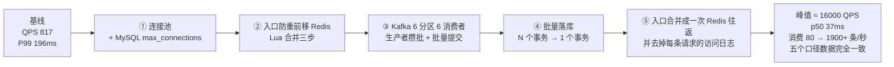

# 秒杀购物平台 · 面试讲解稿

这份稿子的用法：**先背第 1、2 节的框架，再背第 5 节的数字，最后看第 6 节的追问准备**。
第 6 节是面试官最可能深挖的地方，建议对着镜子讲一遍。

## 1. 开场：90 秒讲完项目

> 我做的是一个 Go 语言的电商单体服务，重点做**秒杀**这个高并发场景。
>
> 整体是「注册登录 → 商品 → 购物车 → 下单 → 支付」的常规电商链路，
> 秒杀作为独立页面单独设计。技术栈是 Gin + GORM + MySQL + Redis + Kafka。
>
> 秒杀的核心思路是**把流量挡在数据库外面**：
> 请求进来先在 Redis 里用**一段 Lua 脚本、一次往返**原子地完成「限流 + 活动时间校验 + 请求去重 + 用户限购 + 库存预扣」，
> 扣到了就立刻返回成功并把消息发到 Kafka，真正写 MySQL 的动作交给后台消费端异步做。
>
> 这样 MySQL 就不会被瞬时流量打穿。我做过五轮优化：
> 消费端吞吐从最初约 **80 条/秒** 提升到 **1900 条/秒以上**；
> 入口把 4 次 Redis 往返合并成 1 次之后，单机压测峰值 **约 16,000 QPS**（目标是 1 万），
> 512 并发下 p50 37ms、全部 200、零错误、Kafka 零积压，
> 并且压到最后 `sold`、订单数、去重用户数、去重 `request_id` 数、Redis 剩余库存五个数字完全对得上，没有超卖也没有重复购买。

如果面试官说「展开讲讲」，就进入第 2 节。

## 2. 架构和请求全流程

完整架构图见 `docs/architecture.md`，口头只需要讲这条主线：

```
用户 → Gin(只做鉴权) → Redis(一段 Lua 一次往返：限流+校验+预扣) → Kafka(削峰排队) → 消费端 → MySQL(最终落库)
                             ↑                                                          ↓
                             └──────────── 对账任务每 30 秒兜底 ←─────────────────────┘
```

展开成 5 步：

1. **鉴权**：JWT 解析出 `user_id`，没登录直接 401。
2. **一次 Lua 做完所有判断（最关键的一步）**：整条抢购只跟 Redis 打**一次**交道。
   这一段脚本在 Redis 里原子地做六件事：按用户限流（100 次/秒）、读商品信息、
   读活动时间窗并校验活动有没有开始或结束、判断 `request_id` 是否来过、
   判断该用户是否超限购、扣库存并记录该用户已买数量。
   最后脚本把商品信息**直接 `return` 回来**，省掉一次额外的 `GET`。
   - **为什么必须合成一次**：每一次 Redis 调用都要等一个网络往返，拆开就是 4 个往返；
     隔离基准测出 4 跳的上限只有约 9,000/s，**合并成 1 次后上限约 27,000/s**。
   - **为什么必须用 Lua**：Lua 在 Redis 里单线程原子执行，
     天然避免「先查后扣」之间被并发请求插队导致的超卖。
3. **冷路径兜底**：如果 Redis 里还没有这个商品的缓存（服务刚重启、或者缓存过期），
   脚本会返回「缓存没准备好」，服务就回源 MySQL 读一次商品和活动、写完缓存再重试一次。
   这条路径平时走不到，不影响热路径性能。
4. **异步落库**：预扣成功后把消息发到 Kafka 就立刻返回 200，
   接口返回的订单状态是 `queued`（排队中）。这时 MySQL 里还没有这条记录。
5. **消费端落库**：6 个消费者 goroutine 从 Kafka 批量拉消息，一批最多 200 条，
   在**一个事务**里完成批量查重、批量查限购、按商品汇总扣库存、批量插订单，然后提交消费进度。
   落库后 MySQL 里这条订单的状态是 `pending`。

## 3. 核心设计点（面试官最想听的四个）

### 3.1 怎么保证不超卖

三层防线，性能和正确性分离：

| 层次 | 手段 | 性质 |
| --- | --- | --- |
| Redis Lua | `stock < quantity` 判断后才 `DECRBY`，判断和扣减在同一次原子操作里 | 性能手段 |
| MySQL 条件更新 | `UPDATE ... SET sold = sold + N WHERE id = ? AND sold + N <= total_stock` | 正确性底线 |
| MySQL 唯一索引 | `request_id` 唯一、`(item_id, user_id)` 唯一 | 正确性底线 |

**关键话术**：前两层是「让大部分请求根本到不了数据库」，
第三层是「就算前面全失效，数据库也绝不会写错」。这两件事必须分开设计，
不能指望数据库又能扛并发又不出错。

### 3.2 怎么保证幂等（同一请求不重复下单）

- **入口层**：`request_id` 在 Redis 里存一个标记（TTL 24 小时），
  存在就直接返回「重复的 request_id」，不再往下走。
- **落库层**：MySQL `seckill_orders.request_id` 是唯一索引，
  即使 Redis 标记因为某种原因丢了，重复插入也会被数据库拒绝。
- **批内去重**：同一批 Kafka 消息里如果出现相同的 `request_id`，
  在处理前就判成重复，避免撞唯一索引导致**整批**插入失败。

三层环环相扣，任何一层单独失效都不会出错。

### 3.3 怎么保证消息不丢、不重复

- **不丢**：消费端严格「先处理业务、再 `Commit` 消费进度」。
  如果先提交再处理，进程一崩消息就真丢了；反过来最多是重复消费一次，而重复是幂等的。
- **不重复造成错误**：重复消息落到 MySQL 会被唯一索引挡住，
  消费端把它归类成 `duplicate`。
  **注意：重复消息绝对不能回补 Redis**——它代表 MySQL 里已经有这条订单，
  说明当初那次扣减是真实成交的，再回补一次库存就凭空多出来，等于超卖。
- **兜底**：整批落库失败时，`compensate` 会把 Redis 预扣的库存和用户购买数还回去；
  万一补偿也失败，还有 30 秒一次的对账任务用 MySQL 的账本把 Redis 覆盖回正确值。

### 3.4 为什么用 Kafka，不用别的消息队列

| 对比项 | Kafka（当前选择） | RabbitMQ | Redis List / Stream |
| --- | --- | --- | --- |
| 吞吐 | 单机十万级，天然支持高吞吐 | 万级，更擅长复杂路由 | 十万级但功能少 |
| 顺序性 | **按分区保证顺序**，可以按 `itemID` 做 key 让同一商品的请求进同一分区 | 队列内顺序，但并发消费时顺序难保 | 顺序可控但要做很多自己实现 |
| 持久化 | 磁盘顺序写，可重复消费（改 offset） | 支持，但堆积能力弱 | Redis 是内存，堆积有风险 |
| 水平扩展 | **加分区就能加并行度**，这正是本项目消费端从 1 个消费者扩到 6 个的关键 | 加消费者即可，但单队列上限受限 | 需要自己分片 |
| 适合场景 | 削峰、日志、流式 | 业务解耦、延时队列、复杂路由 | 简单队列 |

**为什么这个项目选 Kafka**：秒杀的特征是**瞬时洪峰 + 短时间大量消息**，
需要「能存住、能堆积、能加消费者并行追」。
卡夫卡的分区模型正好能让 6 个消费者并行消费同一个 topic，
这是本项目消费端吞吐能提升 20 倍以上的结构性前提。

## 4. 优化故事（这是最加分的部分）

不要把优化讲成「我调了几个参数」，要讲成**「我不断找到当前真正的瓶颈并解决它」**：



### 第 ① 轮：先把「连接被打爆」解决掉

- **现象**：并发一上到 500 就开始出现 500，日志里是 `dial tcp 127.0.0.1:3307: connect: connection refused`。
- **原因**：GORM 没设连接池上限，MySQL 默认 `max_connections` 只有 151，连接一多直接被拒。
- **做法**：`SetMaxOpenConns(100)`、`SetMaxIdleConns(50)`、`SetConnMaxLifetime(1h)`，同时把 MySQL 提到 500。
- **结果**：连接拒绝消失，c=100 时 QPS 从 817 提升到 1116。
- **但**：c 继续加到 1000，QPS 反而降了、延迟涨到 1.3 秒——说明瓶颈转移了。

### 第 ② 轮：把数据库从入口链路上「请出去」

- **现象**：连接池打满，但慢查询一个都没有；一查代码发现秒杀入口在 Redis 之前先查了两次 MySQL
  （一次查 `request_id` 是否重复，一次查用户是否买过）。
- **原因**：这两次查询在秒杀场景下是纯浪费——Redis 里明明可以判。
- **做法**：把「请求去重 + 限购判断 + 库存预扣」合并成一段 Lua 脚本，一次 Redis 往返全部搞定。
- **结果**：c=100 时 QPS 从 1116 提升到 1445（+30%），c=500 时从 1698 到 2101。
- **注意点**：合并成一次原子操作还有个额外好处——**避免「先查后扣」之间被并发请求插队导致的超卖**。

### 第 ③ 轮：加并行度（Kafka 侧）

- **现象**：入口不查库了，但活动一结束还是有一堆消息积压，消费追不上。
- **原因**：只有 1 个消费者、1 个分区，而且生产者一条一条发、消费端一条一条提交，
  网络往返次数太多。
- **做法**：
  - topic 从 1 个分区扩到 **6 个分区**，启动 **6 个消费者**（同一个消费组）；
  - 生产者开启攒批：`BatchSize=100`、`BatchTimeout=10ms`；
  - 消费端改成 `FetchBatch` 批量拉、批量 `Commit`；
  - 关键细节：把 `CommitInterval` 设成 0 **关掉后台自动提交**，改成业务处理成功后手动提交，
    否则会出现「消息还没处理，offset 已经被自动提交了」的丢消息风险。
- **结果**：消费端吞吐上来了，Kafka 不再持续积压。

### 第 ④ 轮：批量落库（本轮重点，也是最能体现深度的一轮）

- **现象**：Kafka 侧优化完，消费速率还是只有约 **80 条/秒**。查监控发现
  `Innodb_row_lock_waits` 几乎等于 `Com_commit`——**每次提交都在等行锁**，
  平均每次等 **65 毫秒**。
- **原因**：**一条消息一个事务**，而 6 个消费者处理的都是同一个商品，
  每个事务里都有一句 `UPDATE seckill_items SET sold = sold + 1 WHERE id = ?`。
  MySQL 对同一行同一时刻只允许一个事务修改，于是 6 条流水线全挤在一个收银台前排队。
  **瓶颈从 Kafka 转移到了 MySQL 的行锁上。**
- **做法**：把「N 条消息 = N 个事务」改成「**N 条消息 = 1 个事务**」：

| 原来（每条消息各来一次） | 现在（整批一次） |
| --- | --- |
| N 次 `SELECT ... WHERE request_id = ?` | 1 次 `WHERE request_id IN (...)` |
| N 次 `SELECT ... WHERE user_id = ? AND item_id = ?` | 每个 itemID 一次 `IN (...)` |
| N 次 `UPDATE ... SET sold = sold + 1` | 每个 itemID 一次 `SET sold = sold + N` |
| N 次单条 `INSERT` | 1 次多值 `INSERT ... VALUES (...),(...)` |
| N 次行锁竞争 | **1 次行锁竞争** |

- **结果**（15379 条消息的一轮压测）：

| 指标 | 优化前 | 优化后 |
| --- | --- | --- |
| `Com_commit` 事务提交次数 | 1057 次 / 1057 条消息 | **196 次 / 15379 条消息**（约 78 条/事务） |
| `Innodb_row_lock_waits` 行锁等待 | 1057 | **90** |
| 消费速率 | 约 80 条/秒 | **1900+ 条/秒** |

- **额外踩到的坑**：批量插入时，同一批里如果有两条相同的 `request_id`，
  会撞唯一索引导致**整批**插入失败回滚。所以在处理前先做了一次「批内去重」，
  把同批重复的请求提前判成 `duplicate`。

### 第 ⑤ 轮：把入口的 4 次 Redis 往返合并成 1 次（最能体现深度的一轮）

- **现象**：消费端已经不积压了（Kafka LAG 长期为 0），但入口 QPS 就卡在约 5,900 上不去。
- **定位**：先用隔离基准（不经过 HTTP，直接打 Redis）量出
  「4 次顺序往返」的上限约 9,000/s、「合并成 1 次」的上限约 27,000/s，
  和实测的 5,900 正好对得上——**瓶颈就是这 4 个网络往返**。
- **做法**：把「限流计数 → 读商品信息 → 读活动时间窗 → 校验活动时间 → 幂等判重 →
  限购判断 → 扣库存」全部写进同一个 Lua 脚本，脚本把商品信息直接 `return` 回来，
  连那次 `GET` 都省掉；限流也从中间件搬进脚本，维度从 IP 改成用户
  （抢购必须登录，按用户限流反而更准，换 IP 也躲不掉）。
  缓存没命中时脚本回一个 `-5`，服务回源 MySQL 填缓存后重试一次。
- **结果**：

| 并发 VU | 优化前 QPS | 优化后 QPS | 提升 |
| --- | --- | --- | --- |
| 64 | 5,600 | 10,464 | 1.87× |
| 256 | 6,814 | **16,096** | 2.36× |
| 512 | 6,668 | 14,855 | 2.23× |

  峰值 **约 16,000 QPS**，512 VU 下 p50 从 84.7ms 降到 **37.1ms**，
  各档全部 0 错误、0 限流；压完之后 `sold`、订单数、去重用户数、去重 `request_id` 数、
  `SUM(quantity)`、Redis 剩余库存这几个数字完全一致。
- **额外收获**：整条链路收进一段脚本之后，**原子性反而更强了**
  ——原来是「先读缓存、再扣库存」两次操作，中间理论上还能插进别的请求。
- **下一个天花板在哪**：用 pprof 采了 CPU profile（这是本轮顺手加的能力，
  设 `ENABLE_PPROF=1` 才会开），45% 的时间花在阻塞式 socket 系统调用，
  42% 是 `net.(*conn).Write`（把 HTTP 响应写回去），业务代码几乎不上榜。
  所以再往上不是改代码的事，而是部署层面的事。

### 五轮优化总览

| 轮次 | 瓶颈 | 解决手段 | QPS |
| --- | --- | --- | --- |
| 基线 | MySQL 连接被拒 | — | 817 |
| ① | 连接池 / 最大连接数 | 连接池上限 + MySQL 500 连接 | 1116 |
| ② | 入口的两次 MySQL 查询 | 防重前移 Redis，Lua 合并三步 | 1445 |
| ③ | 消费并行度不足 | 6 分区 + 6 消费者 + 批量收发 | — |
| ④ | **MySQL 行锁竞争** | **整批一个事务** | 约 2000 |
| ⑤ | **入口的 4 次 Redis 往返** | **合并成一段 Lua，只剩 1 次往返** | **约 16000** |

## 5. 数据手册（建议背下来）

**压测结果（批量落库优化后）**

| 压测 | 请求数 | QPS | P99 | Kafka LAG |
| --- | --- | --- | --- | --- |
| 并发 100 / 8 秒 | 15379 | 1915 | 126ms | 归零 |
| 并发 200 / 10 秒 | 20228 | 2012 | 233ms | 全程 0 |
| 并发 600 / 15 秒 | 29236 | 1921 | 620ms | 峰值 368，约 3 秒追平 |

三次压测全部返回 200，**零错误**。

**压测结果（入口合并成一次 Redis 往返之后，k6）**

| 并发 VU | QPS | p50 | p95 | p99 | 错误 / 限流 |
| --- | --- | --- | --- | --- | --- |
| 64 | 10,464 | — | — | — | 0 / 0 |
| 128 | 14,005 | — | — | — | 0 / 0 |
| 256 | **16,096** | — | — | — | 0 / 0 |
| 512 | 14,855 | 37.1ms | 56.7ms | 71.8ms | 0 / 0 |
| 1024 | 15,212 | — | — | — | 0 / 0 |

（「—」表示这一档只导出了 QPS，没有单独记录分位延迟；
同一档优化前的 p50 是 84.7ms，改完降到 37.1ms。）

**一致性核对（多轮压测累积后）**

| 项目 | 数值 |
| --- | --- |
| 秒杀商品总库存 | 200000 |
| MySQL `sold` | 105092 |
| MySQL 订单数 | 105092 |
| MySQL 去重用户数 | 105092 |
| Redis 剩余库存 | 94908 |
| `200000 - 105092` | 94908 |

**结论**：卖出的件数 = 订单数 = 去重用户数，剩余库存正好等于总库存减卖出件数。
没有超卖，没有重复购买，Redis 和 MySQL 最终一致。

**一致性核对（合并 Redis 往返之后，商品 `id=17`，总库存 5,000,000，每人限购 1 件）**

| 项目 | 数值 |
| --- | --- |
| MySQL `sold` | 2,183,529 |
| MySQL 订单数 | 2,183,529 |
| MySQL 去重用户数 | 2,183,529 |
| MySQL 去重 `request_id` 数 | 2,183,529 |
| MySQL `SUM(quantity)` | 2,183,529 |
| Redis 剩余库存 | 2,816,471 |
| `5000000 - 2183529` | 2,816,471 |

Kafka 消费组 6 个分区 **LAG 全部为 0**，全程日志 0 panic、0 补偿失败。

**其它可以报的数字**

- `/seckill/activities`（纯读接口）单机做到 **10166 QPS**，说明读路径本身很轻。
- 秒杀入口最初的基线是 **817 QPS**，P99 196ms。
- 入口优化的前后对比：**5,907 QPS（4 次 Redis 往返）→ 约 16,000 QPS（1 次往返）**。
- Redis 隔离上限：4 次往返约 **9,000/s**，合并成 1 次约 **27,000/s**。
- `/health`（不碰任何业务逻辑）同一台机器上峰值约 **64,000/s**，用来证明「瓶颈不是 HTTP 入口」。
- 单条链路隔离基准：只打 Redis 约 **34,000/s**；Redis + Kafka 全链路约 **30,500/s**；
  只发 Kafka 约 **86,200/s**。说明 Kafka 不是瓶颈。

## 6. 高频追问准备

### Q1：Redis 挂了怎么办？

分三种情况答：

1. **Redis 挂 → 秒杀入口直接不可用**（返回错误而不是放行）。
   这是有意为之：Redis 是预扣的唯一入口，它不在了就不能判断库存和限购，
   此时**宁可拒绝服务也不能放请求进 MySQL**，否则就是超卖。
2. **降级方案**：可以让秒杀接口返回「系统繁忙，请稍后再试」，
   同时普通下单链路不受影响（普通下单走的是 MySQL 事务，不依赖 Redis 预扣）。
3. **数据安全**：Redis 里存的库存是可以**从 MySQL 重新算出来**的
   （`realStock = total_stock - sold`），所以 Redis 整机丢失也不会造成账目错误，
   重启后用对账任务灌一次即可。**这就是「Redis 只做预扣、MySQL 才是账本」的意义。**

追加一句加分：库存和限购这类数据不怕丢（可重建），
但 `request_id` 幂等标记丢了会导致重复请求可能被放行，
不过 MySQL 的唯一索引仍然会挡住，所以整体依然安全。

### Q2：Kafka 堆积怎么办？

按「应急 → 短期 → 长期」三层答：

1. **应急**：加分区 + 加消费者。本项目已经把消费者做成可配置的数组
   （`kafkaConsumerCount`），扩容就是改个数字重启。
2. **短期**：把消费端的批量参数调大（现在是 `consumeBatchSize = 200`），
   让每次事务处理更多消息，减少事务和网络往返次数。
3. **长期**：看是不是热点商品太集中——所有消息都是同一个 `itemID`，
   那再怎么加消费者也绕不开 MySQL 同一行的锁。这时要考虑
   **库存分桶**（把一个商品的 1000 个库存拆成 10 个桶，每个桶独立扣减），
   或者**在 Redis 里就把库存扣完**、MySQL 只做批量归档。

还要补一句：**堆积本身不丢消息**，Kafka 是磁盘持久化的，
只要有足够磁盘就能撑住，真正要防的是「堆积到最后活动结束了还没写完」。

### Q3：库存不一致怎么办？

1. **正常情况不会不一致**：Redis 预扣成功才发 Kafka，
   消费端失败会 `compensate` 回补 Redis。
2. **补偿也失败**：靠 **30 秒一次的对账任务**兜底，
   用 MySQL 的 `total_stock - sold` 重新算一遍 Redis 库存并覆盖。
3. **为什么以 MySQL 为准**：因为 MySQL 是唯一的「账本」，
   Redis 只是「挡箭牌」。挡箭牌坏了可以重做，账本错了才是真事故。
4. **会不会误判**：这里有一个真实的坑，本项目已经踩过并修掉了。
   Redis 已经预扣、MySQL 还没落库时，如果此刻正好触发对账，
   对账会拿偏小的 `sold` 反推库存，把已经卖掉的库存**加回 Redis**，
   于是多放出名额（库存 100 件的活动里就是超卖）。
   实测过：压测结束时 Kafka 里还剩 10,634 条没消费完，正好撞上一次对账，
   Redis 剩余库存比 MySQL 账本多出 10,634。
   **修法**是给队列加两个信号：在途订单计数、每个消费者是否追平过；
   对账只在「没有订单在途、且消费端已经追平」时才允许覆盖 Redis，
   有在途订单就整轮跳过并打日志。
   修复后重跑同样的爆发流量，`Redis剩余 - (总库存 - 已售)` 全程为负（最低 -35,283），
   流量停下后自动收敛到 0。

### Q4：为什么不用分布式锁，而是用 Lua？

Lua 在 Redis 里是**单线程原子执行**的，
一段脚本执行期间不会有别的命令插进来，所以「读库存 → 判断 → 扣库存」天然原子。
分布式锁要额外做加锁、超时、续期、释放，还容易因为锁超时出现两个线程同时进临界区，
复杂度高、性能还更差。**能用一个原子操作解决的事，就不要引入锁。**

### Q5：为什么是单体，不做微服务？

**主动说出「不是不能拆，是现在不该拆」**：

- 用户量还没到需要拆的规模，单体部署简单、调试方便、没有分布式事务。
- 但代码里的模块边界是按微服务切的（每个模块独立的 model/repository/service/handler，
  模块之间只通过 service 接口调用），**随时可以按边界拆出去**。
- 真拆的时候要补的东西我也清楚：服务发现、配置中心、链路追踪、
  跨服务事务要用「本地消息表 + 最终一致」替代现在的单机事务。

### Q6：QPS 到 1 万了吗？怎么做到的？

**按「先测量、再动手」的顺序讲**：

「到了。单机峰值 **约 16,000 QPS**，是 1 万目标的 1.6 倍；
512 并发下 p50 37ms、p95 57ms、p99 72ms，全部 200、0 错误。

过程分四步：

第一步先确认瓶颈在哪。消费端不积压（Kafka LAG 长期为 0），说明压力已经不在下游；
再用同一个脚本压 `/health` 做对照，峰值约 **64,000/s**——
HTTP 入口离天花板还差得远，那 5,900 是秒杀业务链路自己造成的。

第二步把这条链路拆开量。不经过 HTTP，直接用隔离基准打 Redis：
一次秒杀要做 4 次顺序 Redis 往返（限流 1 次 + 商品信息读 1 次 + 活动时间读 1 次 + Lua 预扣 1 次），
**4 跳的上限约 9,000/s；合并成 1 次往返后上限约 27,000/s**。
实测卡在 5,900，正好被这个 9,000 压住，对得上。

第三步才动手改：把限流、读商品信息、校验活动时间、幂等判重、限购、扣库存全部写进一段 Lua，
脚本把商品信息直接 `return` 回来，连那次 `GET` 都省掉；限流从中间件搬进脚本，
维度从 IP 改成用户（抢购必须登录，按用户更准）。缓存没命中时脚本回一个 `-5`，
服务回源 MySQL 填缓存后重试一次。
改完实测提升 1.9~2.4 倍，峰值到 1.6 万；而且**整条链路收进一段脚本之后，原子性反而更强了**。

第四步看下一个天花板：用 pprof 采 CPU profile，45% 的时间在阻塞式 socket 系统调用、
42% 在 `net.(*conn).Write`（把 HTTP 响应写回去），业务代码几乎不上榜。
所以再往上不是改代码的事，而是部署层面（Linux/epoll、`GOMAXPROCS` 调参、长连接、单机多实例）。

这里有个贯穿始终的判断依据：**看 LAG**。如果消费端有积压，说明瓶颈在消费端；
LAG 一直是 0 而 QPS 上不去，说明瓶颈在入口。我这几轮优化就是靠这个决定往哪个方向使劲的。」

### Q7：怎么保证消费端重启后消息不丢？

- 消费进度存在 Kafka 的消费组里，重启后从上次提交的 offset 继续。
- 因为「先处理业务再提交」，最坏情况是重复消费最后一批消息，
  而重复由唯一索引兜住，不会产生错误数据。

### Q8：限流为什么放在秒杀路由，而不是全局？为什么又搬进了 Lua？

因为限流的目的是**保护秒杀这个最脆弱的链路**，全局限流会误伤商品浏览、订单查询这些正常流量。

至于抢购的限流为什么不放在中间件里：**中间件的限流计数本身就是一次独立的 Redis 往返**，
而这一轮优化的核心正是「把入口的往返次数从 4 降到 1」，
外面再套一层 Redis 限流中间件，等于把刚省下来的那一次又加回去。
所以抢购的限流搬进了同一个 Lua 脚本，和扣减共用那一次往返；
代价是维度从 IP 变成了用户——抢购接口必须登录，按用户限流其实更准
（同一个人换 IP 也躲不掉）。

秒杀的**管理类接口**（建活动、建商品、查活动）仍然走 IP 限流中间件
（单 IP 100 次/秒），因为那些接口本来就不在压测热路径上，多一次往返无所谓。

### Q9：`pending` 状态是什么意思，用户体验怎么保证？

`pending` 表示「名额已锁定，订单正在落库」。
因为 Redis 扣减成功基本等于一定落库（除非数据库整体不可用），
所以这个承诺是可信的。用户可以拿到订单号去查详情、或者走支付流程。
如果极端情况下消费端落库失败，会被补偿回滚，
再由一个超时未落库的清理任务把这类订单标记为失败（这是后续可以补的点）。

## 7. 不足与后续规划（主动说，显得清醒）

| 不足 | 后续做法 |
| --- | --- |
| ~~峰值未达 1 万 QPS~~ | **已达成**：峰值约 16,000 QPS。手段是去掉每条请求的访问日志、把入口的 4 次 Redis 往返合并成 1 次、限流搬进 Lua、补 http 超时、调连接池、降低 Kafka 批次超时 |
| 进一步提吞吐只能靠部署层面 | 换 Linux（epoll）、`GOMAXPROCS` 调参、HTTP 长连接、单机多实例 + 负载均衡；代码侧已到天花板（CPU profile 显示时间都在 socket 系统调用上） |
| 限流 key 有极小概率漏设 TTL（`INCR` 与 `EXPIRE` 之间的竞态） | 改用 `EXPIRE NX`，或在对账任务里顺手清理没有 TTL 的限流 key |
| 消费端单条版 `processOrder` 还留着做对照 | 批量版稳定后删掉，减少维护负担 |
| 对账任务可能把「已预扣未落库」的库存加回 | **已修复**：队列维护在途订单计数、以及每个消费者是否追平过，两者都满足才允许覆盖 Redis |
| 限流是固定窗口，边界处可能放过 2 倍流量 | 换成滑动窗口或令牌桶 |
| 秒杀活动信息缓存 5 分钟，改配置要等过期 | 提供主动刷新缓存的管理接口 |
| 没有链路追踪和分布式链路日志 | 接入 OpenTelemetry |
| 订单超时未支付没有自动取消 | 加延时队列或定时扫描 |

## 8. 一句话总结（收尾用）

> 这个项目最核心的一句话是：**把强一致的账本（MySQL）和扛流量的缓冲（Redis + Kafka）分开**，
> 用 Redis 做原子预扣保证不超卖，用 Kafka 削峰让数据库按自己的节奏干活，
> 用 MySQL 的事务和唯一索引守住最后一道底线，
> 再用补偿和对账让两边最终一致。
>
> 优化过程中我最大的收获是：**瓶颈会转移**。
> 解决连接池问题后瓶颈变成入口的 MySQL 查询，
> 解决入口后瓶颈变成消费并行度，
> 解决并行度后瓶颈又变成 MySQL 的行锁。
> 每一步都要重新测量、重新定位，而不是照搬别人的方案。
