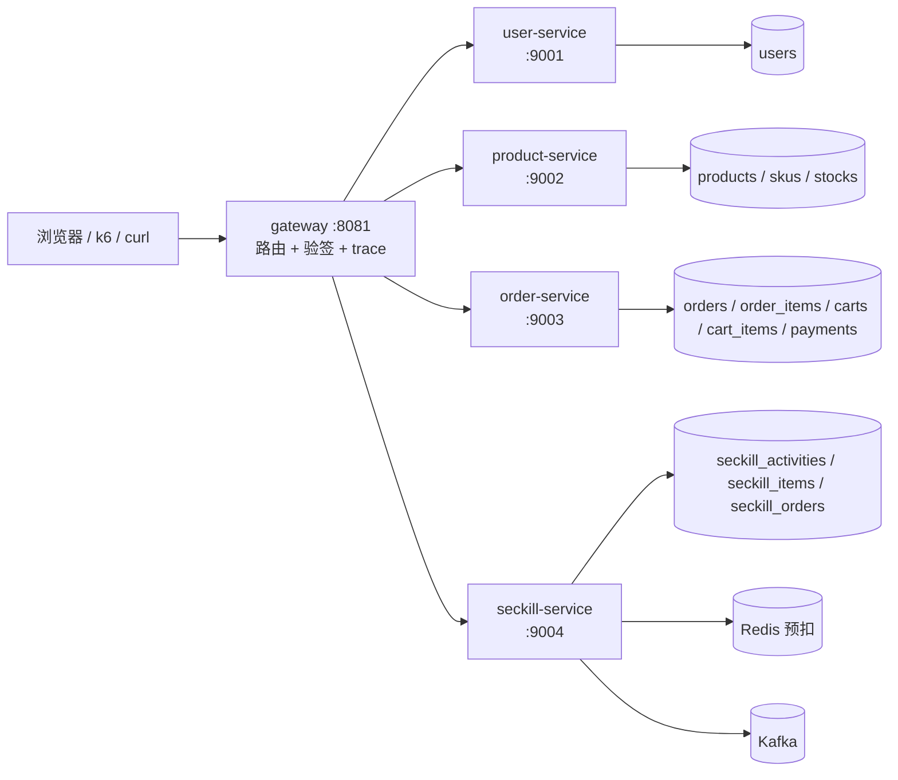

# 微服务拆分设计（讨论稿）

这份文档把「如果要把现在的单体拆成微服务，该怎么拆」讲清楚。它**不是**施工手册，
而是一份**决策记录**：现在的代码长什么样、哪几处是硬骨头、拆完的目标形态、每一步的先后顺序、
以及拆了之后要付出什么代价。

读这份文档之前建议先看 `docs/architecture.md`（现在的单体长什么样）；
配套的面试问法见 `docs/interview.md`。

## 1. 为什么要聊这件事

现在的项目是一个**模块化单体**：一个进程、一个 MySQL 库，但代码已经按业务分成了 9 个包。
这在面试里会迎来一个高频追问：「你为什么不做微服务？」

比「不做」更好的答案是：**我知道要拆的话该从哪切、哪一行最难、要补哪几件事、会付出什么代价。**
这份文档就是把这几件事写下来，作为「想清楚了但按需再拆」的证据。

一句话结论：**这个项目可以拆，而且是贴着现有包边界拆，不需要重写业务代码；
但拆完会丢掉「同库事务」这个便宜，必须额外补上鉴权、trace、幂等和对账四件事。**

## 2. 现状体检

### 2.1 九个业务包，边界约等于未来的服务边界

| 包 | 干什么 | 自带的表 |
| --- | --- | --- |
| `internal/user` | 注册、登录、签发 JWT | `users` |
| `internal/product` | 商品与 SKU 目录 | `products` `skus` |
| `internal/inventory` | SKU 库存扣减与回补 | `stocks` |
| `internal/cart` | 购物车明细 | `carts` `cart_items` |
| `internal/order` | 下单、查单、超时关单 | `orders` `order_items` |
| `internal/payment` | 模拟支付 | `payments` |
| `internal/seckill` | 秒杀活动、抢购、异步落库、对账 | `seckill_activities` `seckill_items` `seckill_orders` |
| `internal/shop` | 前台页面与聚合数据接口 | 无（只读别人的） |
| `internal/demo` | 演示控制台与一键造数据 | 无（往别人的表里写） |

每个包自己带 model + repository + service + handler 四层，对外只暴露 service 接口。
这一点很重要：**拆服务时改的是「怎么调用」，不是「调用什么」。**

### 2.2 跨包依赖只有 4 条

```text
order    -> inventory                 下单时扣库存（同一个数据库事务里）
payment  -> order                     支付前先查订单
shop     -> product, seckill          前台页面要商品目录 + 秒杀活动，在服务端拼成一个 JSON
demo     -> user, product, inventory, seckill   一键造数据，一次写四个模块的表
```

只有 4 条，说明耦合面很窄，**这是能拆的前提**。

### 2.3 关键发现：秒杀自带一套库存池

`seckill_items` 上的 `total_stock` / `sold` 是**独立于 `stocks` 表**的另一套数。
秒杀链路从头到尾不碰 `inventory.stocks`：

- 建秒杀商品时只往 `seckill_items` 插一行，不去 `stocks` 表占位；
- 抢购时扣的是 Redis 里 `seckill:stock:<item_id>` 这个计数；
- 消费端落库时改的是 `seckill_items.sold`（`DeductStockBatch`），不是 `stocks`。

**结论：秒杀模块天生数据自治，可以第一个被拆出去，而且不需要跟库存服务对话。**
这是整个拆分里最省力的一块，也是应该最早拆的一块（详见第 6 节路线）。

## 3. 三处硬耦合

这三处是拆分的真正成本所在，其余 90% 的代码只是「换个调用方式」。

### 3.1 下单扣库存：两模块共用同一个数据库事务（最贵的一行）

见 `internal/order/service.go` 第 67 行附近：

```go
// 在订单自己的事务里，直接调用库存模块，让它用同一个 tx 扣库存
if err := s.inventory.DeductWithDB(tx, item.SKUID, item.Quantity); err != nil {
    return err
}
```

`DeductWithDB(tx, ...)` 的签名里那个 `tx` 说明了一切：订单和库存在**同一个事务**里，
要么都成功、要么都回滚。这是 ACID 给的免费午餐 —— 一旦库存变成另一个进程、另一个库，
这顿饭就没了，必须自己补一套「怎么保证两边都不出错」的机制（第 5.3 节）。

### 3.2 一键造数据：一次写四个模块的表

`internal/demo/handler.go` 第 76 行注册的 `POST /demo/seed`，会连着往 `users`、`products`、
`skus`、`stocks`、`seckill_*` 里写数据。同一个库时这很省事（一个接口准备好整个演示环境），
**拆完第一个坏掉的就是它**——一个接口没法跨四个服务写库。

处理办法：拆完后把 seed 改成「按服务分别调各自的内部接口」，或者干脆退化成
`scripts/seed.sql` 直接灌库（演示环境用后者更省事）。

### 3.3 前台聚合：在服务端 join 两个模块的数据

`internal/shop/handler.go` 的 `Data` 方法同时读商品目录和秒杀活动，在内存里拼成一个 JSON 给页面。
拆完以后商品属于 product-service、秒杀属于 seckill-service，`shop` 只能改成
**网关侧聚合**（并行调两个服务再合并），或者让前端并行拉两个接口。

## 4. 目标形态



| 服务 | 拿走哪些包 | 独占的表 |
| --- | --- | --- |
| gateway | `internal/shop`（页面 + 聚合） | 无 |
| user-service | `internal/user` | `users` |
| product-service | `internal/product` + `internal/inventory` | `products` `skus` `stocks` |
| order-service | `internal/order` + `internal/cart` + `internal/payment` | `orders` `order_items` `carts` `cart_items` `payments` |
| seckill-service | `internal/seckill` | `seckill_activities` `seckill_items` `seckill_orders` |
| console（可选） | `internal/demo` | 无 |

两个刻意的选择：

- **product 和 inventory 合成一个服务**。库存离开了商品没有意义，而且这两张表本来就经常一起查；
  更重要的是这样能少一次跨服务事务（第 3.1 节里 `products` 和 `stocks` 在同一个库）。
- **order / cart / payment 合成一个服务**。这三者共享 `payments` 对 `orders` 的强依赖，
  而且它们的事务边界本来就缠在一起；硬拆成三个服务只会把简单问题做复杂。

**微服务不是「拆得越细越好」，而是「按事务边界和数据归属拆」。** 这句话面试可以直接说。

## 5. 拆分必须补的 5 件事

这 5 件事是「单体时白送、拆开后必须自己实现」的东西。每件都给一个最小方案。

### 5.1 鉴权下沉：网关验一次，下游信头部

单体时每个 handler 各自过 JWT 中间件。拆开后有两条路：

| 方案 | 做法 | 取舍 |
| --- | --- | --- |
| A（推荐） | 网关统一验签，把用户 id 塞进 `X-User-Id` 头，下游无条件信任这个头 | 下游省一次验签；**前提是下游只能从内网访问**，否则攻击者可以伪造这个头 |
| B | 每个服务自己验一遍 | 更安全，但 token 要传到底、每个服务都持有密钥，且每跳多一次 CPU 开销 |

选 A。**不需要把 HS256 换成 RS256**：本项目只有一个签发方（user-service），
对称密钥够用；换 RS256 是多此一举，除非将来有多个签发方。

代价要写清楚：`X-User-Id` 变成一张「内网通行证」，所以部署时下游服务**不能暴露公网端口**。
这条也写进了 `internal/gateway/auth.go` 的注释里。

### 5.2 秒杀热路径不能加跳

秒杀链路现在是这样：一次 Lua 脚本同时完成「限流 + 判重 + 预扣库存」，只走一次 Redis 往返，
这是压到 1 万 QPS 的关键（见 `docs/benchmark.md` 优化记录 7、8）。

**拆服务时这条路径一跳都不能加。** 具体地说：

- 限流、判重、预扣必须留在 seckill-service 进程内，不能拆成「网关限流 + 服务判重 + 库存服务预扣」；
- 网关这一层对秒杀只做**本地验签 + trace 注入**，不做 Redis 调用；
- 下游消费者、对账任务也留在 seckill-service 内。

一句话：**秒杀服务是「高内聚 + 数据自治」的典型，拆它只是把它搬成独立进程，不是把它再切碎。**

### 5.3 下单扣库存的原子性（第 3.1 节那个事务的替代品）

库存搬到 product-service 之后，`DeductWithDB(tx, ...)` 没有了。可选方案：

| 方案 | 思路 | 评价 |
| --- | --- | --- |
| 2PC / TCC / Seata | 分布式事务框架，两阶段提交或补偿 | **明确否决**：引入一个重量级中间件、性能差、运维复杂，面试项目里是负分 |
| 库存服务 RPC + 本地消息表 + 重试（推荐） | order-service 本地事务里写「待扣库存」消息 → 调库存服务扣减 → 成功就标记完成；失败由后台任务重试 | 改动小、可解释、能讲清楚补偿逻辑 |
| 下单只写订单，扣库存走异步 | 订单立即成功，库存异步扣 | 体验好但会超卖，本项目秒杀链路已经用了这套思路，普通下单不该再退化成最终一致 |

推荐第二条。落地步骤：

1. order-service 建 `order_outbox` 表（本地消息表），下单时在**同一个本地事务**里写订单 + 一条待发送的扣库存消息；
2. 事务提交后同步调 product-service 的 `POST /internal/stocks/deduct`；
3. 成功 → 标记消息完成、订单变成 `pending_pay`；失败 → 订单保持「库存待确认」，后台任务按退避重试；
4. 反复失败（超过阈值）→ 关单，返回「库存不足」。

这样至少保证**不会超卖**（扣减在库存服务一侧是原子的），代价是下单延迟多一次内网 RPC（约 1 毫秒量级）。

### 5.4 幂等与跨服务对账

跨服务后网络会重试、消息会重复投递，**每个写操作都必须幂等**。好消息是这个项目已经把幂等键准备好了：

- `orders.request_id`：前端每次下单生成的唯一串，重复提交返回同一张订单；
- `seckill_orders.request_id` + `(user_id, item_id)` 唯一索引：秒杀的两层幂等；
- 秒杀消费端落库走 `INSERT ... ON DUPLICATE KEY UPDATE`，重复消息不会多扣。

拆完后要**新增跨服务对账**：

- 订单侧：`order_outbox` 里「已发未确认」的消息超过 N 分钟，主动查库存服务确认；
- 秒杀侧：现有的对账任务（比对 Redis 计数与 `seckill_items`）保持不变，它本来就是服务内部的；
- 对账结果要能人工介入：对不上就报警 + 落一条待处理记录，而不是静默修数。

### 5.5 trace_id 全程透传

单体时一次请求就是一个函数调用栈，出问题看一个日志文件就够了。拆完之后一次下单会穿过
网关 → order-service → product-service，**没有统一编号就没法把散落的日志串起来**。

最小方案：

- 网关生成 `X-Trace-Id`（请求头里带了就沿用，方便压测工具自己指定）；
- HTTP 调用链：每一跳都把这个头原样往下传；
- Kafka 消息：把 trace id 写进消息头，消费端取出来继续用。

本项目的**阶段 13 就把这层骨架搭好了**（`internal/pkg/trace` + `internal/gateway`），
所以往后每拆一个服务，只要在入口挂上 `trace.Middleware()` 就自动接上了。

## 6. 落地路线

原则：**每一步都能单独验收，且随时可以退回单体。**

| 阶段 | 做什么 | 验收标准 |
| --- | --- | --- |
| 13（已完成） | 抽出 gateway（同进程旁路模式）：先加一层网关，但**业务代码一行不改**，压测仍然直连 8080 | `make run-gateway` 起来后，走 8081 的每次请求都能拿到 `X-Trace-Id`；未登录访问 `/me` 被网关拦下（401） |
| 14（已完成） | 拆 user-service：把 `internal/user` 搬成独立进程，网关把 `/login` `/register` `/me` 转过去 | 网关透传登录后，`/cart/items` 等受保护接口照常工作；单体服务仍可单独启动 |
| 15（已完成） | 拆 seckill-service：搬 `internal/seckill`（含消费者、对账、Redis Lua、Kafka 生产端） | **复测 1 万 QPS**，确认拆进程后热路径没有掉速——实测 128 / 256 / 512 VU 约 **10.5k / 11.2k / 11.5k QPS**，A/B 对照单体 134,910 次 vs 秒杀服务 134,876 次（p50 20.7ms vs 20.6ms），**无掉速** |
| 16 | 拆 product-service（含 inventory），并改造 order 里那条同库事务（第 5.3 节） | 并发下单不超卖；人为把库存服务停掉，订单能正确进入「库存待确认」并被重试，不会静默丢单 |
| 17 | payment / cart 并入 order-service，console 独立；补跨服务对账与 trace 打通 | 全链路一次下单能在日志里按同一个 trace id 串起来 |

阶段 13 之所以用「**旁路式**」：新增 8081 端口，`cmd/server/main.go` 一个字都不动。
好处是零回归风险（原来的 8080 照常压测）、出问题直接不启动网关即可回退，
而且能拿「直连 8080 vs 走 8081」做一次干净的性能对照。

## 7. 代价对照

| 维度 | 现在的单体 | 拆成微服务之后 |
| --- | --- | --- |
| 延迟 | 一次函数调用 | 每跳多 1~3 次网络往返（内网约 0.3~1ms，跨机更高） |
| 一致性 | ACID 事务，天然强一致 | 最终一致，要自己写重试 / 补偿 / 对账 |
| 故障面 | 挂了就是全挂，但原因单一 | 单个服务挂了只影响一部分，但**排查要靠 trace**，链路长 |
| 部署 | 一个二进制 | 6 个进程 + 服务发现 / 配置管理 |
| 性能 | 同机跑最省 CPU | **同机跑多进程会互相抢 CPU，通常比单体 QPS 更低** |
| 开发效率 | 改一个包直接编译 | 要同时起多个服务，调试变慢 |

最后一行要特别强调：**在同一条机器上，微服务的 QPS 通常比单体低**。
要证明拆分的价值，必须跑多机（或至少给不同服务绑不同 CPU）。阶段 15 复测就是在同机前提下做的对照：
把秒杀搬成独立进程后，热路径数字与单体几乎一致（详见 `docs/build.md` 阶段 15 的实测记录），
说明**这次搬家本身没有引入额外开销**（没有新增网络跳数、热路径仍是同一次 Redis 往返）。

## 8. 拆完怎么验收

- **功能**：`docs/build.md` 里的六步验证流程（登录 → 受保护接口 → 秒杀 → 查单 → 支付）在网关链路上全部走通；
- **性能**：阶段 15 已复测秒杀链路，与阶段 6 的 1 万 QPS 基线对照：同机下三档并发都 ≥10.5k QPS、
  0 限流 0 业务失败，A/B 对照证明拆进程无掉速（详见 `docs/build.md` 阶段 15）；跨机差异仍待验证；
- **一致性**：并发下单不超卖；故意注入失败（停掉库存服务 / 杀掉消费者）后，数据能通过重试和对账收敛；
- **可观测**：一次请求的日志能用同一个 trace id 串起来；
- **可回退**：不启动网关、只跑 `cmd/server`，单体模式一切照旧。

## 9. 明确不做的事

写下来是为了避免范围失控：

- **不引入 2PC / TCC / Seata**：开销大于收益，面试讲不出好故事；
- **不做服务发现和配置中心**（etcd / Nacos / Consul）：本项目服务数量固定，环境变量 + 固定端口足够；
- **不做 RS256 密钥轮换**：只有一个签发方，对称密钥就够；
- **不为了拆而拆**：cart 不单独成服务、inventory 不单独成服务，理由见第 4 节。

## 10. 面试怎么讲

如果被问「这个项目为什么不做微服务」，可以按这个顺序答（**这是拆之前的答案**；阶段 13~15 已经真的把网关 / user / seckill 拆了出去，若被追问「拆完怎么样、遇到什么问题」就接第 11 节）：

1. **先讲现状**：单体已经按业务分好包，跨包依赖只有 4 条，边界是清的；
2. **再讲能拆**：包边界就是服务边界，秒杀自带库存池、数据自治，是最容易拆的一块；
3. **讲成本**：真正贵的是订单扣库存那个同库事务、一键造数据、前台聚合这三处；
4. **讲要补什么**：鉴权下沉、幂等与对账、trace 透传；并说明**秒杀热路径绝不能加跳**；
5. **讲代价**：延迟 +1~3 跳、一致性从 ACID 变最终一致、同机跑微服务 QPS 反而更低；
6. **落回结论**：所以阶段 13 之前一直保持单体，但拆分路线已经想清楚了；阶段 13~15 已经按这条路线把 gateway / user / seckill 真的拆了出去，拆的过程、踩的坑和代价见第 11 节。

加分点：主动说出「**微服务是按事务边界和数据归属拆，不是按表拆、更不是拆得越细越好**」。

## 11. 从单体到微服务：改了什么 / 注意什么 / 会出什么问题（实操记录）

前 10 节是**拆之前的设想与决策记录**（阶段 13~15 已在其上标注完成）。
这一节写在第 13~15 阶段真的拆完之后，是一份**实操记录**：每一步具体动了哪些文件、
哪些地方看着没事其实在偷偷出错、以及拆完到底换来了什么、又欠下了什么。

### 11.1 一句话总览

单体就像一个所有人挤在一间厨房的小饭馆：A 要 B 递个盘子，扭头喊一声就行——这就是**函数调用**。
微服务是把小饭馆拆成几间独立小屋：点菜、做菜、收银各占一间，中间只能打电话沟通——这就是**网络请求**。
好处是每间屋子能单独装修、单独开业、单独加班；坏处是电话可能占线、可能听错、还可能有人冒名点单。

本项目没有一次性推倒重来，走的是**渐进式搬家**：

| 阶段 | 搬了什么 | 搬完是什么状态 |
| --- | --- | --- |
| 13 | 先盖门房：`cmd/gateway`（8081），业务代码一行不改 | 旁路模式：8080 照常跑，压测仍直连 8080，随时不启动网关就回退 |
| 14 | 用户模块：`cmd/user`（8082） | 网关把 `/login` `/register` `/me` 转过去 |
| 15 | 秒杀模块：`cmd/seckill`（8083） | 网关把 `/seckill` `/metrics` 转过去；单体用开关让位 |

每一步都能单独验收，出问题就把新进程停掉、回到单体。

### 11.2 具体改了什么

**（1）多了三个独立进程。**
原来只有 `cmd/server`（8080）一个进程跑全部；现在多了 `cmd/gateway`、`cmd/user`、`cmd/seckill`。
单体没有删，只是多了两个开关可以「一键让位」。

**（2）新增网关，它干四件事。**

| 职责 | 文件 | 要点 |
| --- | --- | --- |
| 路由分发 | `internal/gateway/route.go` | 12 条路径前缀 → 6 个服务；匹配取**最长前缀**，否则以后加了 `/products/export` 会被 `/products` 抢走 |
| 公开 / 私有名单 | 同上 | `PublicPaths` 白名单 + `ProtectedPaths`（藏在公开路径底下的私有接口，例如 `/shop/my`），判断顺序必须**先私有再公开** |
| 统一鉴权 | `internal/gateway/auth.go` | JWT 只在网关验一次，验完把用户 ID 写进 `X-User-Id` 请求头，下游直接信这个头 |
| 反向代理 | `internal/gateway/proxy.go` | 按服务复用 `ReverseProxy`（复用连接池）；删掉不该转发的 hop-by-hop 头；透传 `X-Trace-Id` |

**（3）单体加「让位开关」。** 见 `cmd/server/main.go`：

| 环境变量 | 管住什么 |
| --- | --- |
| `USER_MODULE=0` | 不注册用户路由（user 没有后台任务，管住路由就够） |
| `SECKILL_MODULE=0` | 不注册秒杀路由 **+ 不创建 6 个 Kafka 消费者 + 不跑对账 / 关单后台任务** |

两个变量都不设就是原来那个单体（默认全开）。关键词：
**路由和后台任务必须放进同一个开关**，原因见 11.3 第 2 条。

**（4）上游地址配置化。** `GATEWAY_UPSTREAM_USER`、`GATEWAY_UPSTREAM_SECKILL` 这类环境变量一改，
流量就指到新服务；不改就还走老的 8080。等于一个变量就能试水、随时退回。

### 11.3 需要注意什么（每条都是真踩过的）

| # | 注意事项 | 本项目踩到的样子 |
| --- | --- | --- |
| 1 | **热点链路一跳到不能加** | 秒杀的「限流 + 判重 + Redis 预扣」仍然是同一次 Redis Lua 往返；网关对秒杀只做本地验签 + trace，不查库、不查 Redis |
| 2 | **「路由搬走了」≠「活搬走了」** | `SECKILL_MODULE=0` 时 6 个 Kafka 消费者照建，变成僵尸消费者占住分区把消息抢走：抢购返回 200，但订单永远不落库，积压涨到 444 万条 |
| 3 | **信任头默认关，且网关先删伪造头** | 网关写 `X-User-Id` 之前先 `Header.Del(HeaderUserID)`；`SECKILL_TRUST_USER_ID_HEADER` 默认关（默认仍自己验 JWT）；下游服务只监听内网 |
| 4 | **`Director` 和 `Rewrite` 只能留一个** | 改用 `Rewrite` 之后忘了把 `proxy.Director` 置空 → 所有请求 502 |
| 5 | **白名单要做前缀匹配** | 用 `slices.Contains` 做全等比较 → 前台页面整片 401 |
| 6 | **进程内的计数器跨进程不成立** | `Queue.Settled()` 读的是本进程的计数器；两个进程各看到半个世界，对账会把另一个进程刚扣的库存凭空加回去 → 超卖 |
| 7 | **优雅退出要挂 `runCtx`** | 后台任务若照抄单体的 `context.Background()`，收到退出信号不会停，重启瞬间容易丢消息 |
| 8 | **鉴权失败要「响得对」，不能「安静地错」** | 阶段 14 的三个缺陷一个都没让程序崩：类型断言失败让 `/me` 401、`GetUint` 安静返回 0 变成「用户 0」、漏 `return` 拼出非法 JSON、裸令牌被放行 |

第 2 条展开说：Kafka 客户端 `NewReader` **一被创建就自动加入消费组**抢分区，
哪怕你从没让它跑过。所以「不注册路由就等于模块关掉了」这个想法在这里完全不成立——
凡是「一创建就有副作用」的组件（消费者、定时器、连接池），都必须和路由放进同一个开关。
一句话记住：**关模块要连后台一起关，否则就是僵尸进程。**

第 8 条展开说：这类缺陷的共同点是**不让程序崩，只让结果悄悄不对**。
所以每加一层鉴权或转发，都要用「正常 + 畸形 + 缺字段」三类输入各打一遍；
光看「服务还活着」是发现不了这类问题的。

### 11.4 会出现什么问题

第 7 节给的是通用代价表，这里换成「在本项目里具体长什么样」：

| 维度 | 单体 | 拆开之后 | 本项目实际见到的 |
| --- | --- | --- | --- |
| 延迟 | 一次函数调用 | 每跳多 1~3 次网络往返（同机约 0.3~1ms） | 秒杀没加跳，所以热路径几乎没变化 |
| 一致性 | 一个 MySQL 事务，要么全成要么全不成 | 变成**最终一致** | 下单扣库存那条同库事务拆不掉，要留到阶段 16 |
| 故障面 | 挂了全挂，但原因单一 | 只影响一部分 | 多进程之后必须靠 trace 串日志，否则不知道错在哪一环 |
| 部署 | 一个二进制 | 6 个进程 | 用环境变量 + 固定端口顶着，本项目明确不上服务发现 |
| 性能 | 同机跑最省 CPU | 同机多进程抢 CPU，**通常比单体 QPS 更低** | 阶段 15 实测**没掉速**，因为没加跳数（见 11.5） |
| 开发效率 | 改个包直接编译 | 要同时起多个服务 | 调试变慢，是真实成本 |

其中**「最终一致」**单独用大白话解释一下：事务就是「一整套动作要么全做完、要么全不做」；
拆开之后库存和订单分属两个服务、两个库，只能先把订单记下来，再异步去扣库存。
中间那几十毫秒里两边数字是对不上的——**这不是 bug，而是拆分必然要付的代价**，
靠重试、补偿、对账慢慢收敛。

### 11.5 本项目的实测结论

阶段 15 做了一组 A/B 对照（同脚本、同 256 VU）：

| 对象 | 完成请求 | p50 延迟 |
| --- | --- | --- |
| 单体对照（`httpport` 改 8083、仍带秒杀模块的单体二进制） | 134,910 | 20.7ms |
| 秒杀服务（真拆出来的 `cmd/seckill`） | 134,876 | 20.6ms |

三档并发 128 / 256 / 512 VU 分别约 **10.5k / 11.2k / 11.5k QPS**，
全部 **0 限流 / 0 业务失败 / 0 建连错误**；同一个 `request_id` 重放返回 409 且库里只有 1 行；
超时 20 秒关单后 MySQL `status=cancelled`、Redis 库存 79→80、该用户已购 1→0。

结论要说清楚：**「拆完没掉速」不是微服务更快，而是这次搬家没给热路径加跳数。**
换成多机部署才有可能真正更快；同机拆服务通常只会更慢。

### 11.6 还欠着的地方（主动说，别等被问）

- 限购 key `seckill:item:<id>:user:<uid>` **没有 TTL**，压测把 Redis 顶到过 713 万个 key；
- MySQL 里还有约 **442 万条**历史 pending 订单，会拖慢 `ExpireLoop`（每轮只处理 200 笔）；
- `internal/shop/handler.go` 仍在单体进程内**直接函数调用**秒杀服务（演示页面刻意保留，不值得为它绕一圈 HTTP）；
- 阶段 16（product-service，含拆掉那条同库事务）、阶段 17（payment / cart 并入 order）还没做，见第 6 节。
